# BÁO CÁO ĐỒ ÁN ICD MANAGEMENT (100 TRANG)\n\n# CHƯƠNG 1: TỔNG QUAN HỆ THỐNG ICD\n\nICD (Inland Container Depot) quản lý vòng đời container từ hồ sơ hàng hóa, lệnh vận chuyển, tiếp nhận cổng, vị trí bãi, dịch vụ và thanh toán tới phiếu ra cổng, bàn giao và tích hợp đối tác. Hệ thống được xây dựng nhằm hiện đại hóa quy trình làm việc, giảm thời gian chờ đợi tại cổng và nâng cao năng suất tác nghiệp tại bãi thông qua ứng dụng di động.\n\n# CHƯƠNG 2: CƠ SỞ LÝ THUYẾT & KIẾN TRÚC\n\nHệ thống sử dụng kiến trúc Monorepo với Turborepo, bao gồm các ứng dụng: API (NestJS), Web (React), Mobile (React Native/Expo). Cơ sở dữ liệu MySQL được quản lý qua ORM Prisma. Việc triển khai sử dụng Docker container đảm bảo tính nhất quán giữa các môi trường.\n\n# CHƯƠNG 3: PHÂN TÍCH VÀ THIẾT KẾ CƠ SỞ DỮ LIỆU\n\nDự án ICD Management sử dụng cơ sở dữ liệu MySQL thông qua ORM Prisma. Dưới đây là cấu trúc chi tiết của toàn bộ 53 bảng dữ liệu.\n\n## 3.1 Sơ đồ thực thể liên kết (ERD)\n\n```mermaid\nerDiagram\n  User ||--o{ UserRole : assigned\n  Role ||--o{ UserRole : includes\n  Role ||--o{ RolePermission : grants\n  Permission ||--o{ RolePermission : included\n  Manifest ||--o{ MasterBl : contains\n  MasterBl ||--o{ HouseBl : contains\n  Container ||--o{ ContainerVisit : visits\n  TruckVisit ||--o{ TruckVisitContainer : carries\n  ContainerVisit ||--o{ TruckVisitContainer : included\n  ContainerVisit ||--o| ContainerReception : reception\n  YardBlock ||--o{ YardSlot : slots\n  ContainerVisit ||--o{ ContainerLocationLog : locations\n  YardSlot ||--o{ ContainerLocationLog : history\n  ContainerVisit ||--o{ ServiceOrder : services\n  ServiceOrder ||--o{ ServiceOrderItem : items\n  ServiceOrder ||--o| Invoice : invoiced\n  Invoice ||--o{ PaymentAllocation : allocations\n  Payment ||--o{ PaymentAllocation : allocates\n  ContainerVisit ||--o{ GatePass : passes\n```\n\n## 3.2 Chi tiết các bảng dữ liệu (Data Dictionary)\n\n# CHƯƠNG 4: THIẾT KẾ API VÀ PHÂN QUYỀN (RBAC)\n\nHệ thống ICD sử dụng kiến trúc RESTful API xây dựng trên nền tảng NestJS. Phân quyền áp dụng mô hình Role-Based Access Control (RBAC).\n\nHệ thống cung cấp tổng cộng **205** endpoints. Dưới đây là danh mục chi tiết.\n\n### 4.x Module: AUDIT-LOGS\n\n| Method | Đường dẫn (URL) | Yêu cầu quyền (Permission) | Endpoint |\n|---|---|---|---|\n| **GET** | `/api/audit-logs` | JWT (audit.read) | list |\n| **GET** | `/api/audit-logs/entity/:entityType/:entityId` | JWT (audit.read) | findByEntity |\n| **GET** | `/api/audit-logs/request/:requestId` | JWT (audit.read) | findByRequestId |\n\n### 4.x Module: AUTH\n\n| Method | Đường dẫn (URL) | Yêu cầu quyền (Permission) | Endpoint |\n|---|---|---|---|\n| **POST** | `/api/auth/login` | PUBLIC | login |\n| **POST** | `/api/auth/logout` | JWT | logout |\n| **GET** | `/api/auth/me` | JWT | me |\n| **POST** | `/api/auth/refresh` | PUBLIC | refresh |\n\n### 4.x Module: ADMIN\n\n| Method | Đường dẫn (URL) | Yêu cầu quyền (Permission) | Endpoint |\n|---|---|---|---|\n| **GET** | `/api/admin/service-types` | JWT (billing.read) | listServiceTypes |\n| **GET** | `/api/admin/tariffs` | JWT (billing.read) | findTariffs |\n| **POST** | `/api/admin/tariffs` | JWT (tariff.manage) | createTariff |\n| **GET** | `/api/admin/tariffs/:id` | JWT (billing.read) | findTariffById |\n| **PATCH** | `/api/admin/tariffs/:id` | JWT (tariff.manage) | updateTariff |\n| **POST** | `/api/admin/tariffs/:id/activate` | JWT (tariff.manage) | activateTariff |\n| **POST** | `/api/admin/tariffs/:id/retire` | JWT (tariff.manage) | retireTariff |\n| **POST** | `/api/admin/tariffs/:id/rules` | JWT (tariff.manage) | addTariffRule |\n| **DELETE** | `/api/admin/tariffs/:id/rules/:ruleId` | JWT (tariff.manage) | removeTariffRule |\n| **GET** | `/api/admin/master-data` | JWT (master_data.read) | findAll |\n| **POST** | `/api/admin/master-data/:type` | JWT (master_data.manage) | create |\n| **PATCH** | `/api/admin/master-data/:type/:id` | JWT (master_data.manage) | update |\n| **GET** | `/api/admin/master-data/clearing-agents` | JWT (master_data.read) | findMany |\n| **POST** | `/api/admin/master-data/clearing-agents` | JWT (master_data.manage) | create |\n| **GET** | `/api/admin/master-data/clearing-agents/:id` | JWT (master_data.read) | findById |\n| **PATCH** | `/api/admin/master-data/clearing-agents/:id` | JWT (master_data.manage) | update |\n| **POST** | `/api/admin/master-data/clearing-agents/:id/activate` | JWT (master_data.manage) | activate |\n| **POST** | `/api/admin/master-data/clearing-agents/:id/deactivate` | JWT (master_data.manage) | deactivate |\n| **GET** | `/api/admin/master-data/consignees` | JWT (master_data.read) | findMany |\n| **POST** | `/api/admin/master-data/consignees` | JWT (master_data.manage) | create |\n| **GET** | `/api/admin/master-data/consignees/:id` | JWT (master_data.read) | findById |\n| **PATCH** | `/api/admin/master-data/consignees/:id` | JWT (master_data.manage) | update |\n| **POST** | `/api/admin/master-data/consignees/:id/activate` | JWT (master_data.manage) | activate |\n| **POST** | `/api/admin/master-data/consignees/:id/deactivate` | JWT (master_data.manage) | deactivate |\n| **GET** | `/api/admin/master-data/shipping-lines` | JWT (master_data.read) | findMany |\n| **POST** | `/api/admin/master-data/shipping-lines` | JWT (master_data.manage) | create |\n| **GET** | `/api/admin/master-data/shipping-lines/:id` | JWT (master_data.read) | findById |\n| **PATCH** | `/api/admin/master-data/shipping-lines/:id` | JWT (master_data.manage) | update |\n| **POST** | `/api/admin/master-data/shipping-lines/:id/activate` | JWT (master_data.manage) | activate |\n| **POST** | `/api/admin/master-data/shipping-lines/:id/deactivate` | JWT (master_data.manage) | deactivate |\n| **GET** | `/api/admin/master-data/transporters` | JWT (master_data.read) | findMany |\n| **POST** | `/api/admin/master-data/transporters` | JWT (master_data.manage) | create |\n| **GET** | `/api/admin/master-data/transporters/:id` | JWT (master_data.read) | findById |\n| **PATCH** | `/api/admin/master-data/transporters/:id` | JWT (master_data.manage) | update |\n| **POST** | `/api/admin/master-data/transporters/:id/activate` | JWT (master_data.manage) | activate |\n| **POST** | `/api/admin/master-data/transporters/:id/deactivate` | JWT (master_data.manage) | deactivate |\n| **GET** | `/api/admin/partner-api-logs` | JWT (partner_api_log.read) | findMany |\n| **GET** | `/api/admin/partner-api-logs/:id` | JWT (partner_api_log.read) | findById |\n| **GET** | `/api/admin/partner-clients` | JWT (partner_client.manage) | findMany |\n| **POST** | `/api/admin/partner-clients` | JWT (partner_client.manage) | create |\n| **GET** | `/api/admin/partner-clients/:id` | JWT (partner_client.manage) | findById |\n| **POST** | `/api/admin/partner-clients/:id/revoke` | JWT (partner_client.manage) | revoke |\n| **POST** | `/api/admin/partner-clients/:id/rotate` | JWT (partner_client.manage) | rotateKey |\n| **GET** | `/api/admin/permissions` | JWT (roles.read) | findMany |\n| **GET** | `/api/admin/roles` | JWT (roles.read) | findMany |\n| **POST** | `/api/admin/roles` | JWT (roles.manage) | create |\n| **GET** | `/api/admin/roles/:roleId` | JWT (roles.read) | findById |\n| **PATCH** | `/api/admin/roles/:roleId` | JWT (roles.manage) | update |\n| **PUT** | `/api/admin/roles/:roleId/permissions` | JWT (roles.manage) | replacePermissions |\n| **GET** | `/api/admin/settings` | JWT (settings.read) | findMany |\n| **PATCH** | `/api/admin/settings/:key` | JWT (settings.manage) | update |\n| **GET** | `/api/admin/users` | JWT (users.read) | findMany |\n| **POST** | `/api/admin/users` | JWT (users.manage) | create |\n| **GET** | `/api/admin/users/:userId` | JWT (users.read) | findById |\n| **PATCH** | `/api/admin/users/:userId` | JWT (users.manage) | update |\n| **POST** | `/api/admin/users/:userId/activate` | JWT (users.manage) | activate |\n| **POST** | `/api/admin/users/:userId/deactivate` | JWT (users.manage) | deactivate |\n| **PUT** | `/api/admin/users/:userId/password` | JWT (users.manage) | resetPassword |\n| **PUT** | `/api/admin/users/:userId/roles` | JWT (users.manage) | replaceRoles |\n\n### 4.x Module: CONTAINERS\n\n| Method | Đường dẫn (URL) | Yêu cầu quyền (Permission) | Endpoint |\n|---|---|---|---|\n| **GET** | `/api/containers/:containerVisitId/billing` | JWT (billing.read) | checkReadiness |\n| **POST** | `/api/containers/:visitId/service-orders` | JWT (billing.manage) | createDraftOrder |\n| **GET** | `/api/containers` | JWT (container.read) | findAll |\n| **POST** | `/api/containers` | JWT (container.create) | createVisit |\n| **GET** | `/api/containers/:visitId` | JWT (container.read) | findById |\n| **PATCH** | `/api/containers/:visitId` | JWT (container.update) | updateVisit |\n| **POST** | `/api/containers/:visitId/cancel` | JWT (container.cancel) | cancelVisit |\n| **GET** | `/api/containers/:visitId/events` | JWT (container.read) | getEvents |\n| **POST** | `/api/containers/:visitId/gate-in` | JWT (gate_in.create) | gateIn |\n| **GET** | `/api/containers/:visitId/gate-in-context` | JWT (gate_in.create) | getContext |\n| **GET** | `/api/containers/:visitId/reception` | JWT (container.read) | getReception |\n| **GET** | `/api/containers/:visitId/gate-pass` | JWT (container.read) | findActiveGatePass |\n| **POST** | `/api/containers/:visitId/gate-pass` | JWT (gate_pass.create) | issue |\n| **GET** | `/api/containers/:visitId/gate-pass/readiness` | JWT (container.read) | checkReadiness |\n| **GET** | `/api/containers/:visitId/gate-passes` | JWT (container.read) | findManyForVisit |\n| **POST** | `/api/containers/:visitId/movement-orders` | JWT (movement_order.create) | createForContainer |\n| **GET** | `/api/containers/:visitId/holds` | JWT (operational_hold.read) | findManyForVisit |\n| **POST** | `/api/containers/:visitId/holds` | JWT (operational_hold.manage) | create |\n| **POST** | `/api/containers/:visitId/holds/:holdId/release` | JWT (operational_hold.manage) | release |\n| **GET** | `/api/containers/:visitId/handover-summary` | JWT (handover.read) | findSummary |\n| **GET** | `/api/containers/work-queue` | JWT | getWorkQueue |\n| **GET** | `/api/containers/work-queue/stats` | JWT | getStats |\n| **POST** | `/api/containers/:visitId/inspections` | JWT (yard.inspect) | requestInspection |\n| **POST** | `/api/containers/:visitId/yard-bookings` | JWT (yard.booking) | createBooking |\n| **POST** | `/api/containers/:visitId/yard/assign` | JWT (yard.update) | assign |\n| **POST** | `/api/containers/:visitId/yard/check` | JWT (yard.update) | checkSlot |\n| **GET** | `/api/containers/:visitId/yard/location` | JWT (yard.read) | currentLocation |\n| **POST** | `/api/containers/:visitId/yard/movements` | JWT (yard.move) | requestMovement |\n| **GET** | `/api/containers/:visitId/yard/operations/active-summary` | JWT (yard.read) | getActiveSummary |\n| **GET** | `/api/containers/:visitId/yard/recommendations` | JWT (yard.read) | recommendations |\n\n### 4.x Module: INVOICES\n\n| Method | Đường dẫn (URL) | Yêu cầu quyền (Permission) | Endpoint |\n|---|---|---|---|\n| **GET** | `/api/invoices` | JWT (billing.read) | findMany |\n| **GET** | `/api/invoices/:id` | JWT (billing.read) | findById |\n| **POST** | `/api/invoices/:invoiceId/payments` | JWT (billing.manage) | create |\n\n### 4.x Module: PAYMENTS\n\n| Method | Đường dẫn (URL) | Yêu cầu quyền (Permission) | Endpoint |\n|---|---|---|---|\n| **GET** | `/api/payments` | JWT (billing.read) | findMany |\n| **GET** | `/api/payments/:id` | JWT (billing.read) | findById |\n\n### 4.x Module: SERVICE-ORDERS\n\n| Method | Đường dẫn (URL) | Yêu cầu quyền (Permission) | Endpoint |\n|---|---|---|---|\n| **GET** | `/api/service-orders` | JWT (billing.read) | findServiceOrders |\n| **GET** | `/api/service-orders/:id` | JWT (billing.read) | findServiceOrderById |\n| **POST** | `/api/service-orders/:id/cancel` | JWT (billing.manage) | cancelOrder |\n| **POST** | `/api/service-orders/:id/confirm` | JWT (billing.manage) | confirmOrder |\n| **POST** | `/api/service-orders/:id/recalculate` | JWT (billing.manage) | recalculateDraftOrder |\n| **POST** | `/api/service-orders/:serviceOrderId/invoice` | JWT (billing.manage) | issueInvoice |\n| **POST** | `/api/service-orders/preview` | JWT (billing.read) | previewBilling |\n\n### 4.x Module: INTEGRATIONS\n\n| Method | Đường dẫn (URL) | Yêu cầu quyền (Permission) | Endpoint |\n|---|---|---|---|\n| **GET** | `/api/integrations/edi/acks` | JWT (edi.read) | listAcks |\n| **GET** | `/api/integrations/edi/acks/:id` | JWT (edi.read) | getAckById |\n| **POST** | `/api/integrations/edi/acks/ingest` | JWT (edi.ack.ingest) | ingestAck |\n| **GET** | `/api/integrations/edi/alerts` | JWT (edi.read) | listAlerts |\n| **GET** | `/api/integrations/edi/alerts/:id` | JWT (edi.read) | getAlertById |\n| **POST** | `/api/integrations/edi/alerts/:id/acknowledge` | JWT (edi.alert.manage) | acknowledgeAlert |\n| **POST** | `/api/integrations/edi/alerts/:id/resolve` | JWT (edi.alert.manage) | resolveAlert |\n| **POST** | `/api/integrations/edi/alerts/sync` | JWT (edi.alert.manage) | syncAlerts |\n| **POST** | `/api/integrations/edi/dispatch` | JWT (edi.dispatch) | triggerDispatch |\n| **GET** | `/api/integrations/edi/outbox` | JWT (edi.read) | listOutbox |\n| **GET** | `/api/integrations/edi/outbox/:id` | JWT (edi.read) | getOutboxById |\n| **POST** | `/api/integrations/edi/outbox/:id/retry` | JWT (edi.manage) | retryOutbox |\n| **GET** | `/api/integrations/edi/routes` | JWT (edi.read) | getRoutes |\n| **PUT** | `/api/integrations/edi/routes/:shippingLineId` | JWT (edi.manage) | updateRoute |\n\n### 4.x Module: GATE-OUT\n\n| Method | Đường dẫn (URL) | Yêu cầu quyền (Permission) | Endpoint |\n|---|---|---|---|\n| **POST** | `/api/gate-out` | JWT (gate_pass.use) | confirmGateOut |\n\n### 4.x Module: GATE-PASS\n\n| Method | Đường dẫn (URL) | Yêu cầu quyền (Permission) | Endpoint |\n|---|---|---|---|\n| **POST** | `/api/gate-pass/scan` | JWT (gate_pass.use) | scan |\n\n### 4.x Module: GATE-PASSES\n\n| Method | Đường dẫn (URL) | Yêu cầu quyền (Permission) | Endpoint |\n|---|---|---|---|\n| **POST** | `/api/gate-passes/:gatePassId/cancel` | JWT (gate_pass.create) | cancel |\n| **GET** | `/api/gate-passes/:gatePassId/qr` | JWT (gate_pass.create) | getQr |\n\n### 4.x Module: HEALTH\n\n| Method | Đường dẫn (URL) | Yêu cầu quyền (Permission) | Endpoint |\n|---|---|---|---|\n| **GET** | `/api/health` | PUBLIC | check |\n| **GET** | `/api/health/live` | PUBLIC | live |\n| **GET** | `/api/health/ready` | PUBLIC | ready |\n\n### 4.x Module: MANIFESTS\n\n| Method | Đường dẫn (URL) | Yêu cầu quyền (Permission) | Endpoint |\n|---|---|---|---|\n| **GET** | `/api/manifests` | JWT (manifest.read) | list |\n| **POST** | `/api/manifests` | JWT (manifest.create) | create |\n| **GET** | `/api/manifests/:manifestId` | JWT (manifest.read) | getDetail |\n| **PATCH** | `/api/manifests/:manifestId` | JWT (manifest.update) | update |\n| **POST** | `/api/manifests/:manifestId/cancel` | JWT (manifest.cancel) | cancel |\n| **GET** | `/api/manifests/:manifestId/master-bls` | JWT (manifest.read) | list |\n| **POST** | `/api/manifests/:manifestId/master-bls` | JWT (manifest.update) | create |\n| **DELETE** | `/api/manifests/:manifestId/master-bls/:mblId` | JWT (manifest.update) | remove |\n| **PATCH** | `/api/manifests/:manifestId/master-bls/:mblId` | JWT (manifest.update) | update |\n| **GET** | `/api/manifests/:manifestId/master-bls/:mblId/house-bls` | JWT (manifest.read) | list |\n| **POST** | `/api/manifests/:manifestId/master-bls/:mblId/house-bls` | JWT (manifest.update) | create |\n| **DELETE** | `/api/manifests/:manifestId/master-bls/:mblId/house-bls/:hblId` | JWT (manifest.update) | remove |\n| **PATCH** | `/api/manifests/:manifestId/master-bls/:mblId/house-bls/:hblId` | JWT (manifest.update) | update |\n| **POST** | `/api/manifests/:manifestId/submit` | JWT (manifest.submit) | submit |\n\n### 4.x Module: MOVEMENT-ORDERS\n\n| Method | Đường dẫn (URL) | Yêu cầu quyền (Permission) | Endpoint |\n|---|---|---|---|\n| **GET** | `/api/movement-orders` | JWT (movement_order.read) | findAll |\n| **GET** | `/api/movement-orders/:orderId` | JWT (movement_order.read) | findById |\n| **PATCH** | `/api/movement-orders/:orderId` | JWT (movement_order.update) | update |\n| **POST** | `/api/movement-orders/:orderId/authorize` | JWT (movement_order.authorize) | authorize |\n| **POST** | `/api/movement-orders/:orderId/cancel` | JWT (movement_order.cancel) | cancel |\n\n### 4.x Module: NOTIFICATIONS\n\n| Method | Đường dẫn (URL) | Yêu cầu quyền (Permission) | Endpoint |\n|---|---|---|---|\n| **PATCH** | `/api/notifications/:id/read` | JWT | markAsRead |\n| **GET** | `/api/notifications/history` | JWT | getHistory |\n| **POST** | `/api/notifications/read-all` | JWT | markAllAsRead |\n| **POST** | `/api/notifications/register-device` | JWT | registerDevice |\n| **DELETE** | `/api/notifications/unregister-device` | JWT | unregisterDevice |\n\n### 4.x Module: OPERATIONAL-HOLDS\n\n| Method | Đường dẫn (URL) | Yêu cầu quyền (Permission) | Endpoint |\n|---|---|---|---|\n| **GET** | `/api/operational-holds/:holdId` | JWT (operational_hold.read) | findById |\n\n### 4.x Module: CUSTOMER-WAREHOUSES\n\n| Method | Đường dẫn (URL) | Yêu cầu quyền (Permission) | Endpoint |\n|---|---|---|---|\n| **GET** | `/api/customer-warehouses` | JWT (master_data.read) | findMany |\n| **POST** | `/api/customer-warehouses` | JWT (master_data.manage) | create |\n| **GET** | `/api/customer-warehouses/:id` | JWT (master_data.read) | findById |\n| **PATCH** | `/api/customer-warehouses/:id` | JWT (master_data.manage) | update |\n\n### 4.x Module: HANDOVERS\n\n| Method | Đường dẫn (URL) | Yêu cầu quyền (Permission) | Endpoint |\n|---|---|---|---|\n| **GET** | `/api/handovers` | JWT (handover.read) | findMany |\n| **POST** | `/api/handovers` | JWT (handover.create) | create |\n| **GET** | `/api/handovers/:id` | JWT (handover.read) | findById |\n| **POST** | `/api/handovers/:id/dispute` | JWT (handover.dispute) | dispute |\n| **POST** | `/api/handovers/:id/icd-confirm` | JWT (handover.confirm) | icdConfirm |\n| **POST** | `/api/handovers/:id/publish` | JWT (handover.create) | publish |\n\n### 4.x Module: V1\n\n| Method | Đường dẫn (URL) | Yêu cầu quyền (Permission) | Endpoint |\n|---|---|---|---|\n| **GET** | `/api/v1/external/handovers` | PARTNER_API_KEY | list |\n| **GET** | `/api/v1/external/handovers/:handoverId` | PARTNER_API_KEY | getDetail |\n| **POST** | `/api/v1/external/handovers/:handoverId/accept` | PARTNER_API_KEY | accept |\n| **POST** | `/api/v1/external/handovers/:handoverId/delivery-failed` | PARTNER_API_KEY | deliveryFailed |\n| **POST** | `/api/v1/external/handovers/:handoverId/in-transit` | PARTNER_API_KEY | markInTransit |\n| **POST** | `/api/v1/external/handovers/:handoverId/reject` | PARTNER_API_KEY | reject |\n| **POST** | `/api/v1/external/handovers/:handoverId/warehouse-received` | PARTNER_API_KEY | warehouseReceived |\n\n### 4.x Module: REPORTS\n\n| Method | Đường dẫn (URL) | Yêu cầu quyền (Permission) | Endpoint |\n|---|---|---|---|\n| **GET** | `/api/reports/container-turnover` | JWT (reports.read) | getContainerTurnover |\n| **GET** | `/api/reports/export.xlsx` | JWT (reports.read) | exportExcel |\n| **GET** | `/api/reports/gate-activity` | JWT (reports.read) | getGateActivity |\n| **GET** | `/api/reports/outstanding-debt` | JWT (reports.read) | getOutstandingDebt |\n| **GET** | `/api/reports/revenue` | JWT (reports.read) | getRevenue |\n| **GET** | `/api/reports/summary` | JWT (reports.read) | getDashboardSummary |\n| **GET** | `/api/reports/yard-inventory/current` | JWT (reports.read) | getCurrentYardInventory |\n| **GET** | `/api/reports/yard-inventory/eod` | JWT (reports.read) | getYardInventoryEod |\n\n### 4.x Module: GATE\n\n| Method | Đường dẫn (URL) | Yêu cầu quyền (Permission) | Endpoint |\n|---|---|---|---|\n| **GET** | `/api/gate/truck-visits` | JWT (truck_visit.read) | findAll |\n| **POST** | `/api/gate/truck-visits` | JWT (truck_visit.create) | create |\n| **GET** | `/api/gate/truck-visits/:visitId` | JWT (truck_visit.read) | findById |\n| **POST** | `/api/gate/truck-visits/:visitId/arrive` | JWT (truck_visit.arrive) | arrive |\n| **POST** | `/api/gate/truck-visits/:visitId/cancel` | JWT (truck_visit.cancel) | cancel |\n\n### 4.x Module: INSPECTIONS\n\n| Method | Đường dẫn (URL) | Yêu cầu quyền (Permission) | Endpoint |\n|---|---|---|---|\n| **POST** | `/api/inspections/:id/cancel` | JWT (yard.inspect) | cancelInspection |\n| **POST** | `/api/inspections/:id/complete` | JWT (yard.inspect) | completeInspection |\n| **POST** | `/api/inspections/:id/start` | JWT (yard.inspect) | startInspection |\n\n### 4.x Module: YARD\n\n| Method | Đường dẫn (URL) | Yêu cầu quyền (Permission) | Endpoint |\n|---|---|---|---|\n| **GET** | `/api/yard/blocks` | JWT (yard.read) | findBlocks |\n| **POST** | `/api/yard/blocks` | JWT (yard.configure) | createBlock |\n| **PATCH** | `/api/yard/blocks/:blockId` | JWT (yard.configure) | updateBlock |\n| **POST** | `/api/yard/blocks/:blockId/slots` | JWT (yard.configure) | createSlot |\n| **GET** | `/api/yard/bookings` | JWT (yard.read) | findBookings |\n| **GET** | `/api/yard/bookings/:id` | JWT (yard.read) | getBookingById |\n| **POST** | `/api/yard/bookings/:id/cancel` | JWT (yard.booking) | cancelBooking |\n| **POST** | `/api/yard/bookings/:id/complete` | JWT (yard.booking) | completeBooking |\n| **POST** | `/api/yard/bookings/:id/start` | JWT (yard.booking) | startBooking |\n| **GET** | `/api/yard/inspections` | JWT (yard.read) | findInspections |\n| **GET** | `/api/yard/inspections/:id` | JWT (yard.read) | getInspectionById |\n| **GET** | `/api/yard/movements` | JWT (yard.read) | findMovements |\n| **GET** | `/api/yard/movements/:id` | JWT (yard.read) | getMovementById |\n| **POST** | `/api/yard/movements/:id/cancel` | JWT (yard.move) | cancelMovement |\n| **POST** | `/api/yard/movements/:id/complete` | JWT (yard.move) | completeMovement |\n| **POST** | `/api/yard/movements/:id/start` | JWT (yard.move) | startMovement |\n| **GET** | `/api/yard/slots` | JWT (yard.read) | findSlots |\n| **PATCH** | `/api/yard/slots/:slotId` | JWT (yard.configure) | updateSlot |\n\n# CHƯƠNG 5: TRIỂN KHAI GIAO DIỆN VÀ TÍCH HỢP MOBILE\n\nPhân hệ Mobile được xây dựng bằng React Native và Expo, phục vụ cho các nhân viên tác nghiệp tại hiện trường cảng ICD.\n\nDưới đây là chi tiết giao diện với **92** màn hình chức năng.\n\n\n\nGiao diện 00 Initial được thiết kế tối ưu trên thiết bị di động, hỗ trợ cả chế độ Sáng (Light mode) và Tối (Dark mode), giúp nhân viên dễ quan sát ngoài trời nắng gắt hoặc ban đêm.\n\n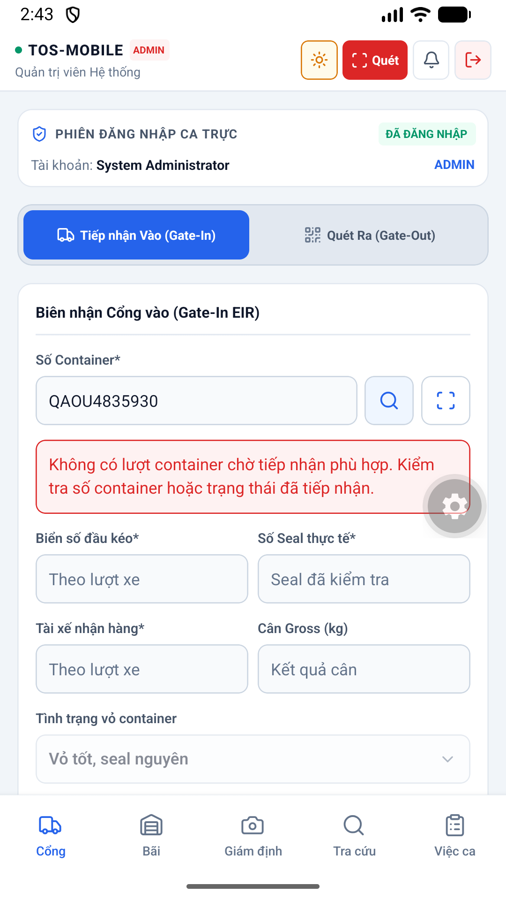\n\nMàn hình 01 Gate Out Light thuộc phân hệ Cổng. Hỗ trợ nhân viên bảo vệ quét mã QR, đối chiếu thông tin xe tải, tình trạng kẹp chì (seal) và ghi nhận thời gian xe ra vào ICD chính xác.\n\n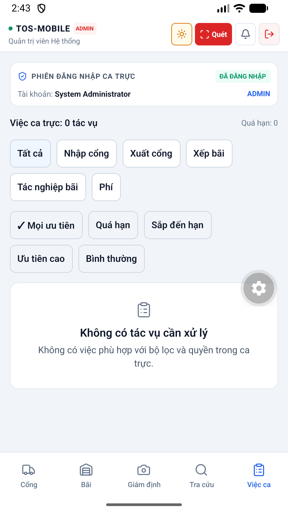\n\nGiao diện 02 Workqueue Light được thiết kế tối ưu trên thiết bị di động, hỗ trợ cả chế độ Sáng (Light mode) và Tối (Dark mode), giúp nhân viên dễ quan sát ngoài trời nắng gắt hoặc ban đêm.\n\n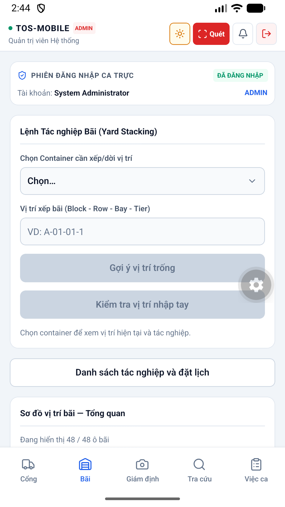\n\nMàn hình 03 Yard Light thuộc phân hệ Bãi. Giúp nhân viên điều độ xe nâng gán vị trí (Block, Bay, Row, Tier) cho container trên bản đồ bãi dạng lưới 2D.\n\n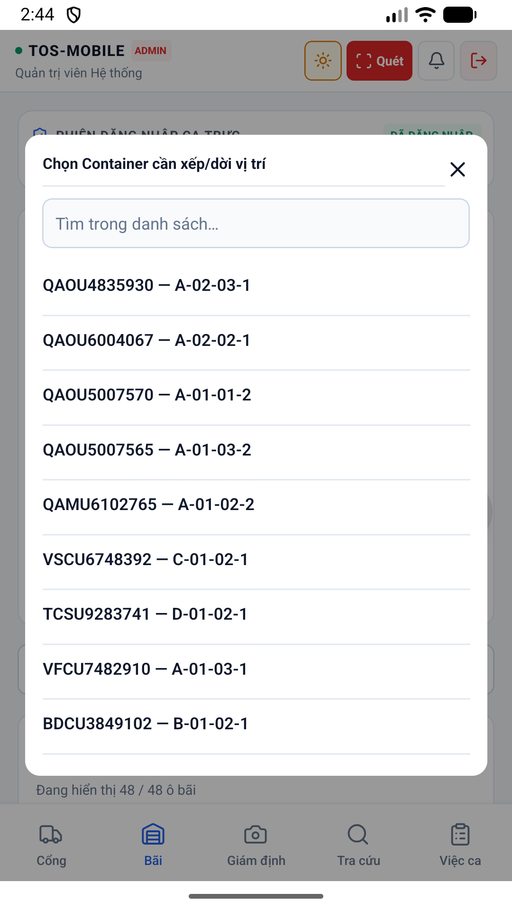\n\nMàn hình 04 Yard Select Light thuộc phân hệ Bãi. Giúp nhân viên điều độ xe nâng gán vị trí (Block, Bay, Row, Tier) cho container trên bản đồ bãi dạng lưới 2D.\n\n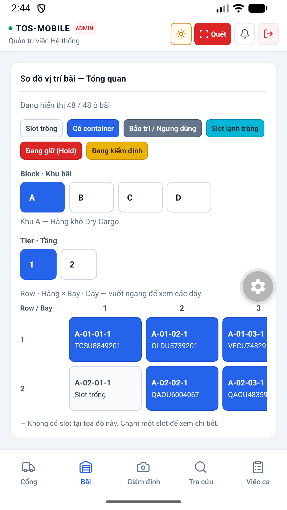\n\nMàn hình 05 Yard Map Light thuộc phân hệ Bãi. Giúp nhân viên điều độ xe nâng gán vị trí (Block, Bay, Row, Tier) cho container trên bản đồ bãi dạng lưới 2D.\n\n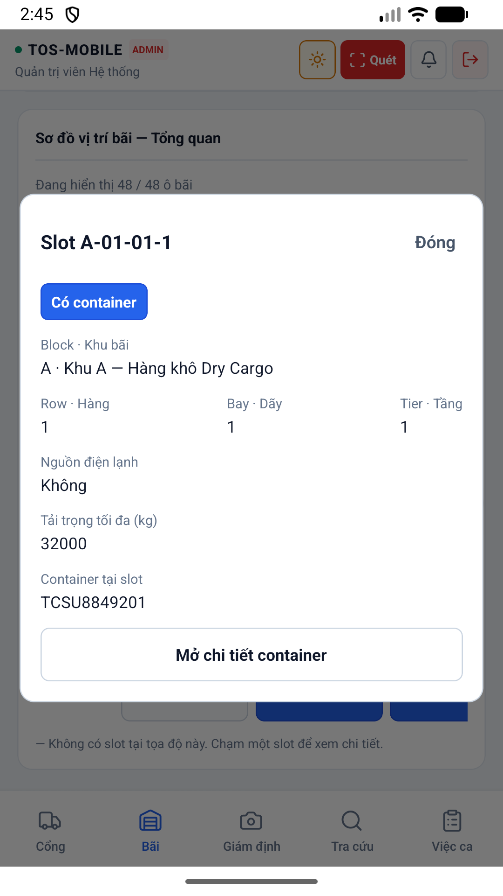\n\nMàn hình 06 Yard Slot Light thuộc phân hệ Bãi. Giúp nhân viên điều độ xe nâng gán vị trí (Block, Bay, Row, Tier) cho container trên bản đồ bãi dạng lưới 2D.\n\n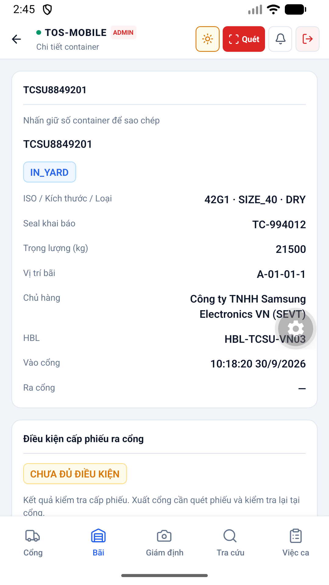\n\nGiao diện 07 Container Detail Light được thiết kế tối ưu trên thiết bị di động, hỗ trợ cả chế độ Sáng (Light mode) và Tối (Dark mode), giúp nhân viên dễ quan sát ngoài trời nắng gắt hoặc ban đêm.\n\n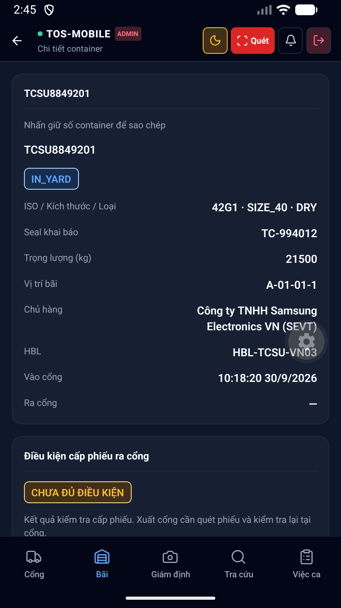\n\nGiao diện 08 Container Detail Dark được thiết kế tối ưu trên thiết bị di động, hỗ trợ cả chế độ Sáng (Light mode) và Tối (Dark mode), giúp nhân viên dễ quan sát ngoài trời nắng gắt hoặc ban đêm.\n\n\n\nMàn hình 09 Yard Map Dark thuộc phân hệ Bãi. Giúp nhân viên điều độ xe nâng gán vị trí (Block, Bay, Row, Tier) cho container trên bản đồ bãi dạng lưới 2D.\n\n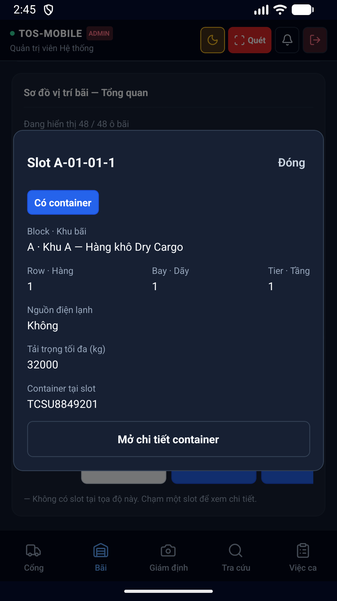\n\nMàn hình 10 Yard Slot Dark thuộc phân hệ Bãi. Giúp nhân viên điều độ xe nâng gán vị trí (Block, Bay, Row, Tier) cho container trên bản đồ bãi dạng lưới 2D.\n\n\n\nMàn hình 11 Yard Dark thuộc phân hệ Bãi. Giúp nhân viên điều độ xe nâng gán vị trí (Block, Bay, Row, Tier) cho container trên bản đồ bãi dạng lưới 2D.\n\n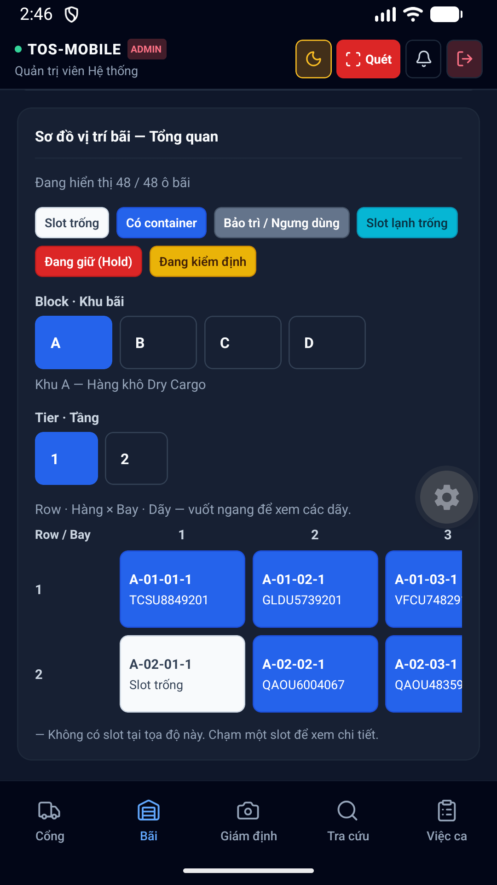\n\nGiao diện 12 Current được thiết kế tối ưu trên thiết bị di động, hỗ trợ cả chế độ Sáng (Light mode) và Tối (Dark mode), giúp nhân viên dễ quan sát ngoài trời nắng gắt hoặc ban đêm.\n\n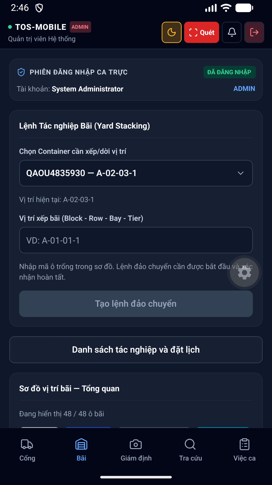\n\nMàn hình 13 Yard Dark thuộc phân hệ Bãi. Giúp nhân viên điều độ xe nâng gán vị trí (Block, Bay, Row, Tier) cho container trên bản đồ bãi dạng lưới 2D.\n\n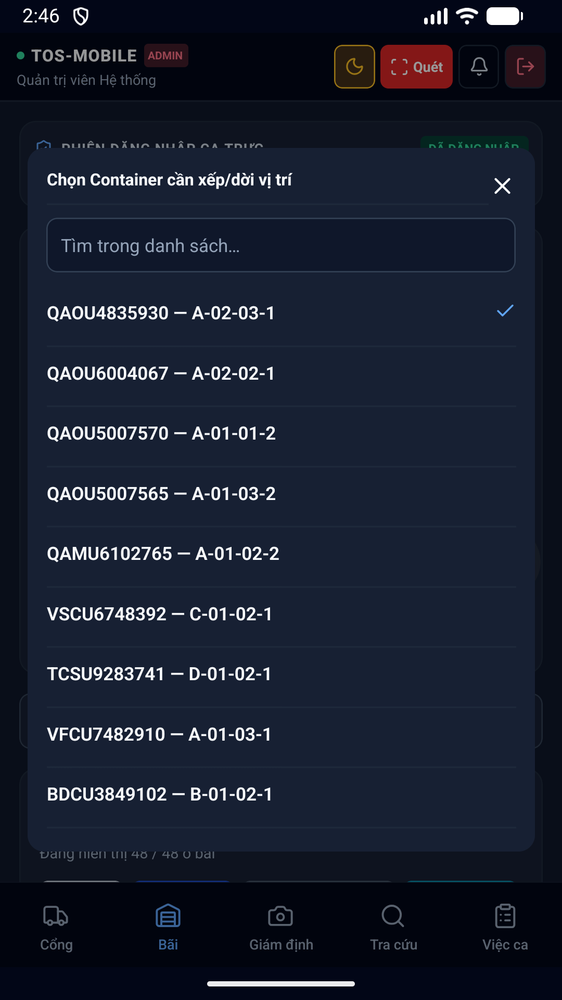\n\nMàn hình 14 Yard Select Dark thuộc phân hệ Bãi. Giúp nhân viên điều độ xe nâng gán vị trí (Block, Bay, Row, Tier) cho container trên bản đồ bãi dạng lưới 2D.\n\n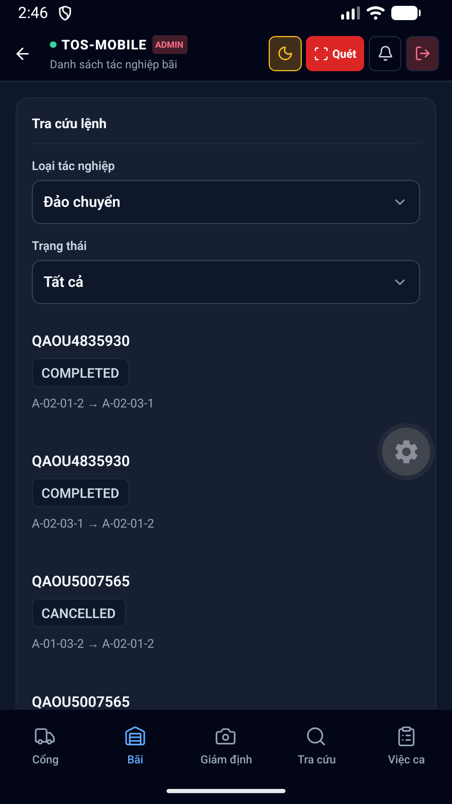\n\nMàn hình 15 Yard Operations Dark thuộc phân hệ Bãi. Giúp nhân viên điều độ xe nâng gán vị trí (Block, Bay, Row, Tier) cho container trên bản đồ bãi dạng lưới 2D.\n\n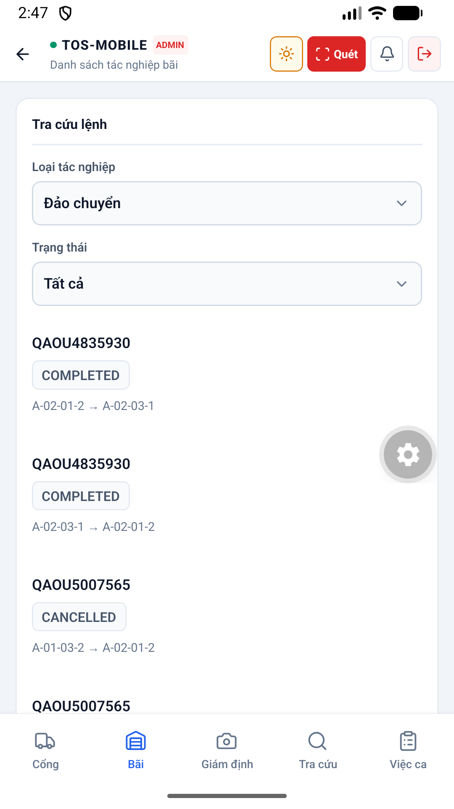\n\nMàn hình 16 Yard Operations Light thuộc phân hệ Bãi. Giúp nhân viên điều độ xe nâng gán vị trí (Block, Bay, Row, Tier) cho container trên bản đồ bãi dạng lưới 2D.\n\n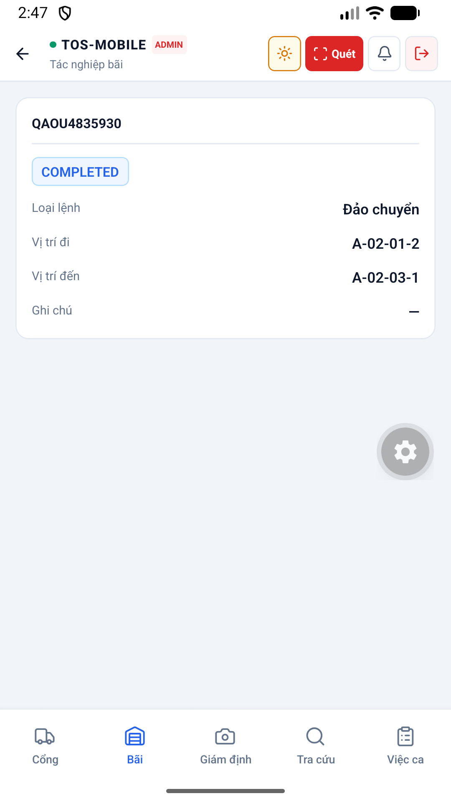\n\nMàn hình 17 Yard Operation Detail Light thuộc phân hệ Bãi. Giúp nhân viên điều độ xe nâng gán vị trí (Block, Bay, Row, Tier) cho container trên bản đồ bãi dạng lưới 2D.\n\n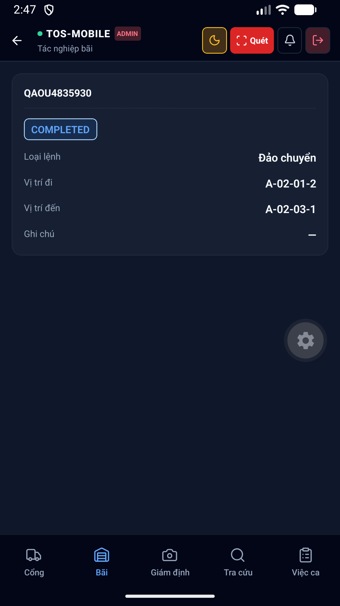\n\nMàn hình 18 Yard Operation Detail Dark thuộc phân hệ Bãi. Giúp nhân viên điều độ xe nâng gán vị trí (Block, Bay, Row, Tier) cho container trên bản đồ bãi dạng lưới 2D.\n\n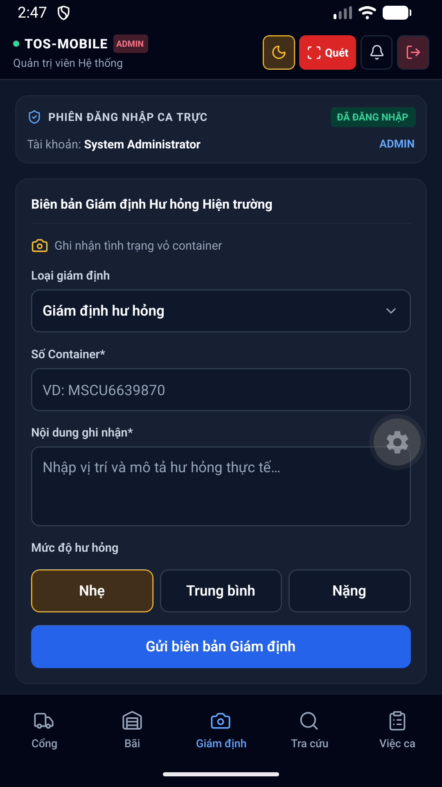\n\nMàn hình 19 Survey Dark hỗ trợ nhân viên Giám định (Surveyor) ghi nhận tình trạng hư hỏng của vỏ container bằng cách chọn các mã lỗi chuẩn quốc tế.\n\n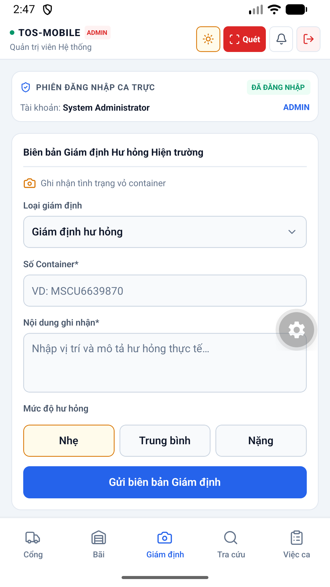\n\nMàn hình 20 Survey Light hỗ trợ nhân viên Giám định (Surveyor) ghi nhận tình trạng hư hỏng của vỏ container bằng cách chọn các mã lỗi chuẩn quốc tế.\n\n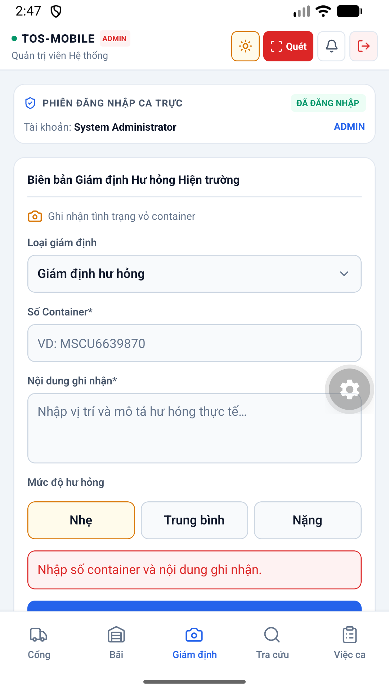\n\nMàn hình 21 Survey Validation Light hỗ trợ nhân viên Giám định (Surveyor) ghi nhận tình trạng hư hỏng của vỏ container bằng cách chọn các mã lỗi chuẩn quốc tế.\n\n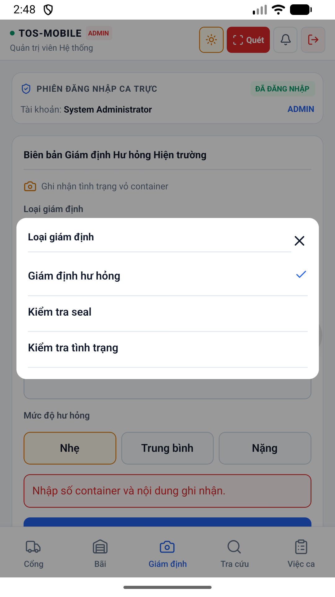\n\nMàn hình 22 Survey Picker Light hỗ trợ nhân viên Giám định (Surveyor) ghi nhận tình trạng hư hỏng của vỏ container bằng cách chọn các mã lỗi chuẩn quốc tế.\n\n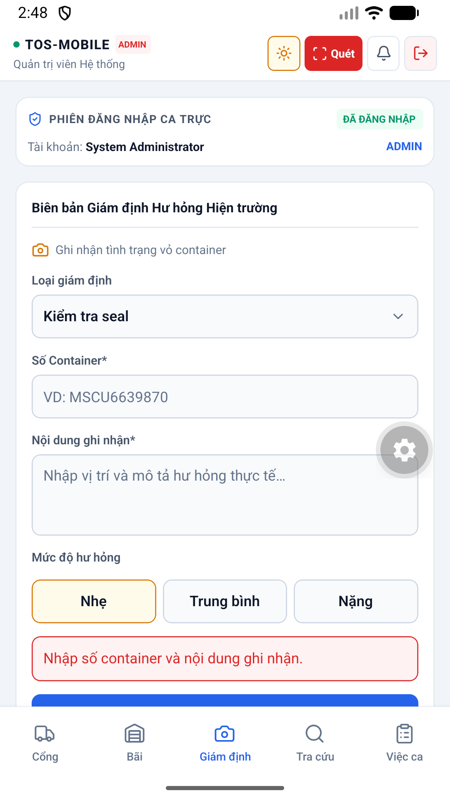\n\nMàn hình 23 Survey Seal Light hỗ trợ nhân viên Giám định (Surveyor) ghi nhận tình trạng hư hỏng của vỏ container bằng cách chọn các mã lỗi chuẩn quốc tế.\n\n\n\nMàn hình 24 Survey Picker Dark hỗ trợ nhân viên Giám định (Surveyor) ghi nhận tình trạng hư hỏng của vỏ container bằng cách chọn các mã lỗi chuẩn quốc tế.\n\n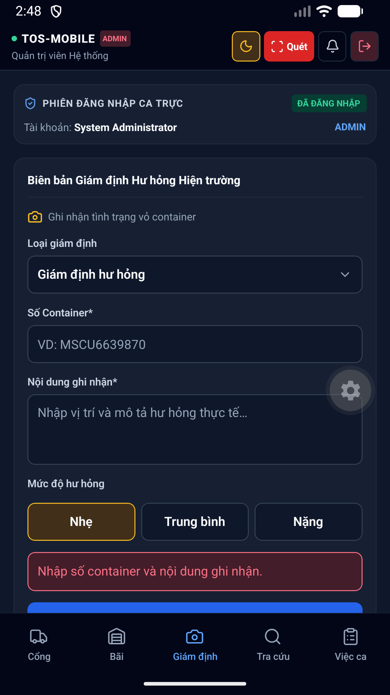\n\nMàn hình 25 Survey Keyboard Dark hỗ trợ nhân viên Giám định (Surveyor) ghi nhận tình trạng hư hỏng của vỏ container bằng cách chọn các mã lỗi chuẩn quốc tế.\n\n\n\nMàn hình 26 Survey Current Dark hỗ trợ nhân viên Giám định (Surveyor) ghi nhận tình trạng hư hỏng của vỏ container bằng cách chọn các mã lỗi chuẩn quốc tế.\n\n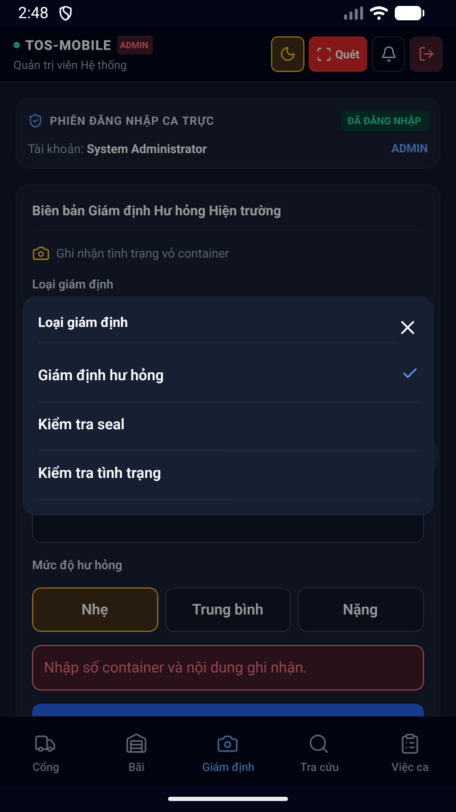\n\nMàn hình 27 Survey Picker Dark hỗ trợ nhân viên Giám định (Surveyor) ghi nhận tình trạng hư hỏng của vỏ container bằng cách chọn các mã lỗi chuẩn quốc tế.\n\n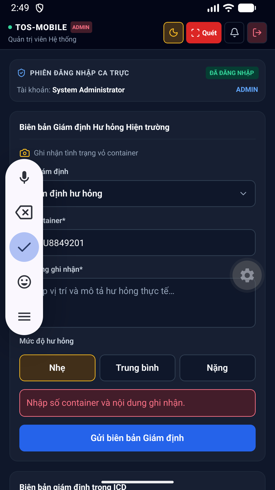\n\nMàn hình 28 Survey Keyboard Dark hỗ trợ nhân viên Giám định (Surveyor) ghi nhận tình trạng hư hỏng của vỏ container bằng cách chọn các mã lỗi chuẩn quốc tế.\n\n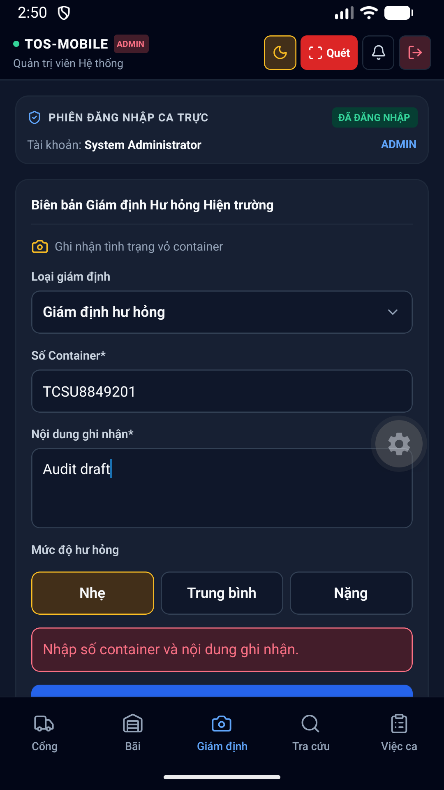\n\nMàn hình 29 Survey Draft Dark hỗ trợ nhân viên Giám định (Surveyor) ghi nhận tình trạng hư hỏng của vỏ container bằng cách chọn các mã lỗi chuẩn quốc tế.\n\n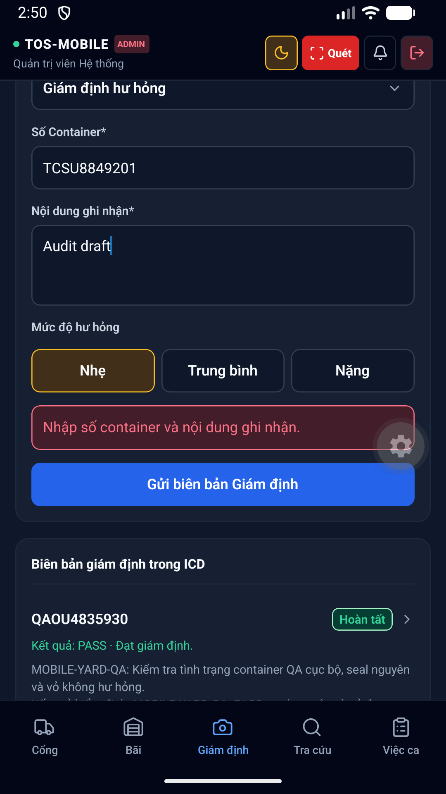\n\nMàn hình 30 Survey Draft Bottom Dark hỗ trợ nhân viên Giám định (Surveyor) ghi nhận tình trạng hư hỏng của vỏ container bằng cách chọn các mã lỗi chuẩn quốc tế.\n\n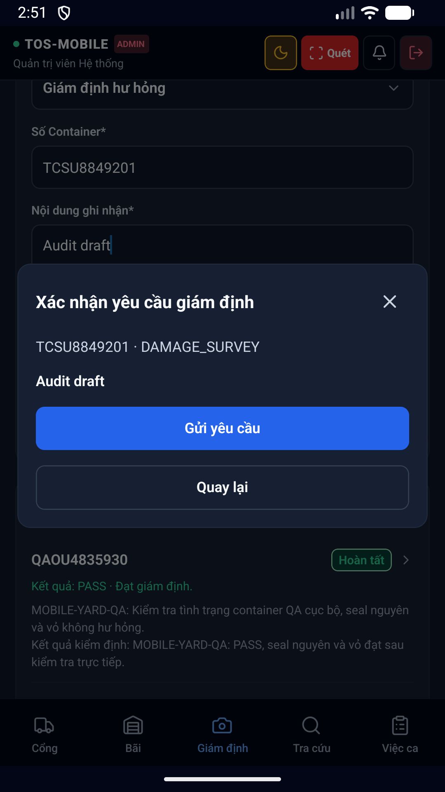\n\nMàn hình 31 Survey Confirm Dark hỗ trợ nhân viên Giám định (Surveyor) ghi nhận tình trạng hư hỏng của vỏ container bằng cách chọn các mã lỗi chuẩn quốc tế.\n\n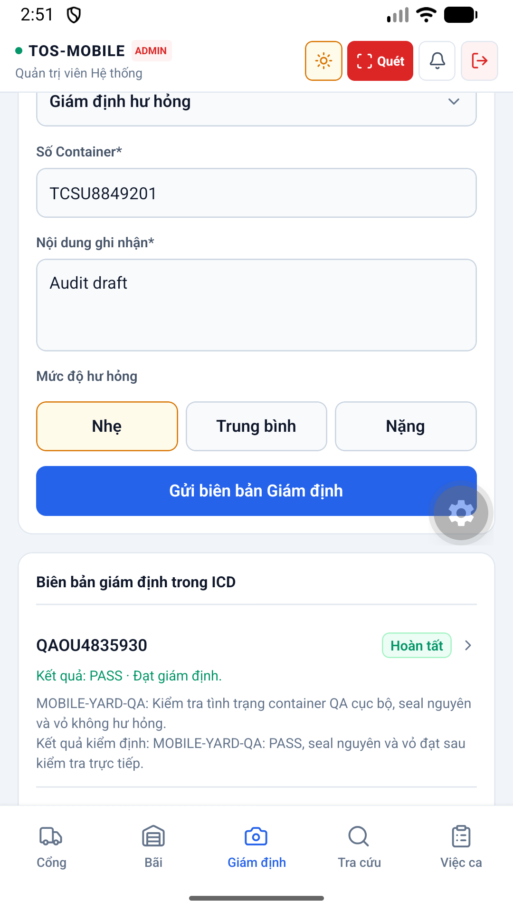\n\nMàn hình 32 Survey Confirm Light hỗ trợ nhân viên Giám định (Surveyor) ghi nhận tình trạng hư hỏng của vỏ container bằng cách chọn các mã lỗi chuẩn quốc tế.\n\n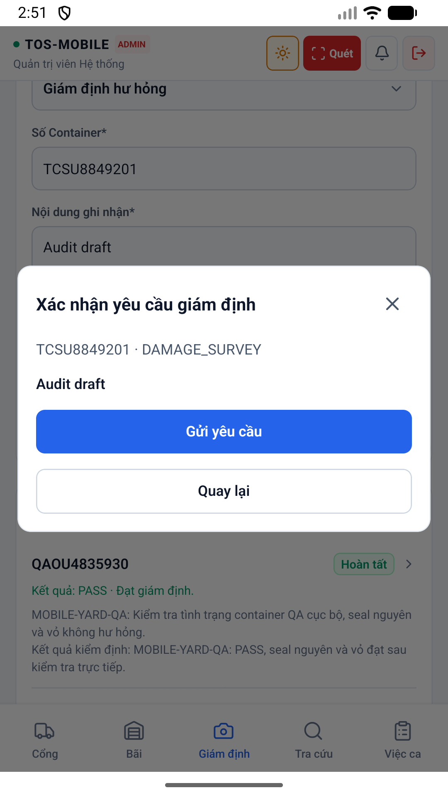\n\nMàn hình 33 Survey Confirm Light hỗ trợ nhân viên Giám định (Surveyor) ghi nhận tình trạng hư hỏng của vỏ container bằng cách chọn các mã lỗi chuẩn quốc tế.\n\n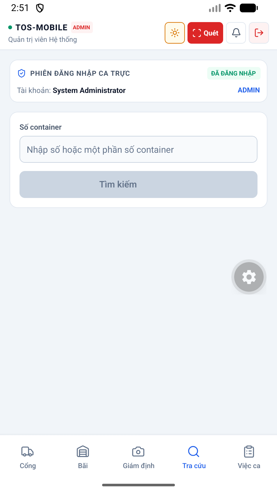\n\nGiao diện 34 Lookup Light được thiết kế tối ưu trên thiết bị di động, hỗ trợ cả chế độ Sáng (Light mode) và Tối (Dark mode), giúp nhân viên dễ quan sát ngoài trời nắng gắt hoặc ban đêm.\n\n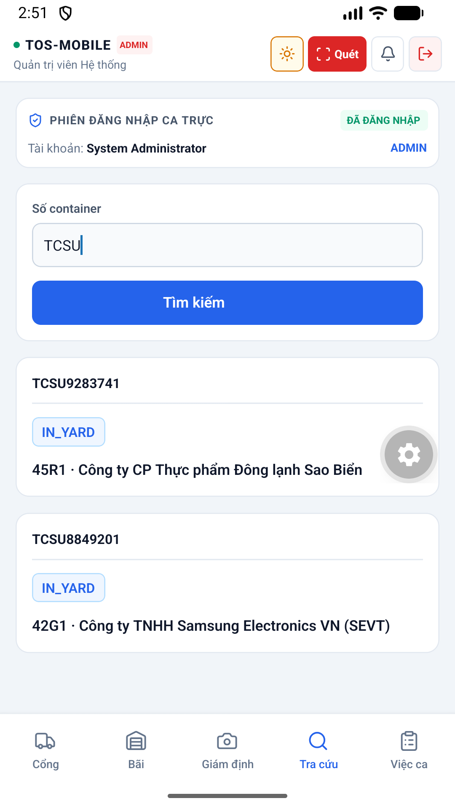\n\nGiao diện 35 Lookup Results Light được thiết kế tối ưu trên thiết bị di động, hỗ trợ cả chế độ Sáng (Light mode) và Tối (Dark mode), giúp nhân viên dễ quan sát ngoài trời nắng gắt hoặc ban đêm.\n\n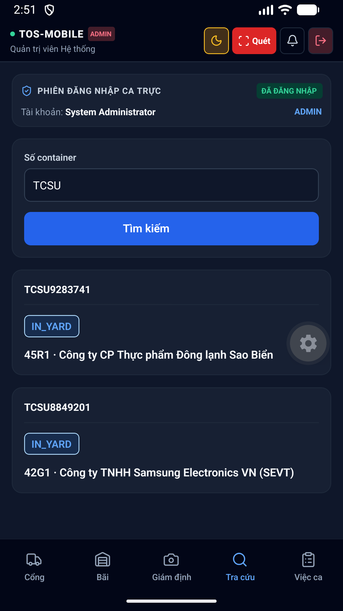\n\nGiao diện 36 Lookup Results Dark được thiết kế tối ưu trên thiết bị di động, hỗ trợ cả chế độ Sáng (Light mode) và Tối (Dark mode), giúp nhân viên dễ quan sát ngoài trời nắng gắt hoặc ban đêm.\n\n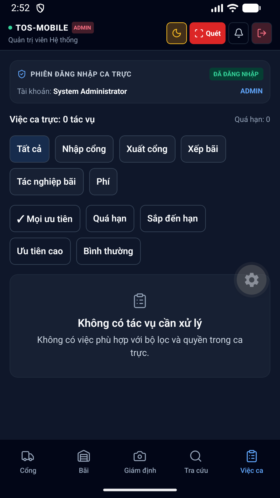\n\nGiao diện 37 Workqueue Dark được thiết kế tối ưu trên thiết bị di động, hỗ trợ cả chế độ Sáng (Light mode) và Tối (Dark mode), giúp nhân viên dễ quan sát ngoài trời nắng gắt hoặc ban đêm.\n\n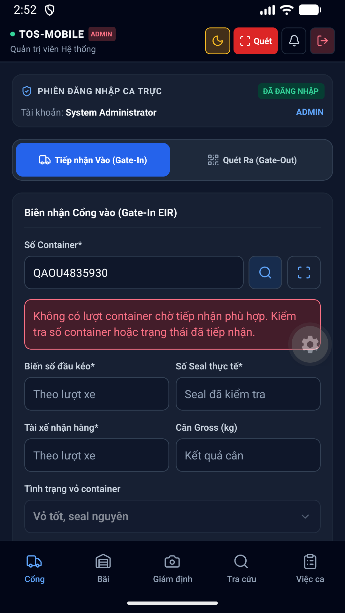\n\nMàn hình 38 Gate In Dark thuộc phân hệ Cổng. Hỗ trợ nhân viên bảo vệ quét mã QR, đối chiếu thông tin xe tải, tình trạng kẹp chì (seal) và ghi nhận thời gian xe ra vào ICD chính xác.\n\n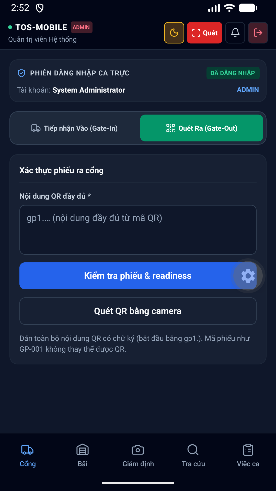\n\nMàn hình 39 Gate Out Dark thuộc phân hệ Cổng. Hỗ trợ nhân viên bảo vệ quét mã QR, đối chiếu thông tin xe tải, tình trạng kẹp chì (seal) và ghi nhận thời gian xe ra vào ICD chính xác.\n\n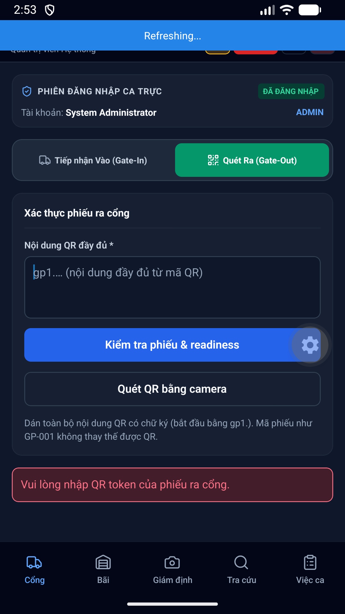\n\nMàn hình 41 Gate Out Blank Validation Dark thuộc phân hệ Cổng. Hỗ trợ nhân viên bảo vệ quét mã QR, đối chiếu thông tin xe tải, tình trạng kẹp chì (seal) và ghi nhận thời gian xe ra vào ICD chính xác.\n\n\n\nGiao diện 42 Scanner Ready Dark được thiết kế tối ưu trên thiết bị di động, hỗ trợ cả chế độ Sáng (Light mode) và Tối (Dark mode), giúp nhân viên dễ quan sát ngoài trời nắng gắt hoặc ban đêm.\n\n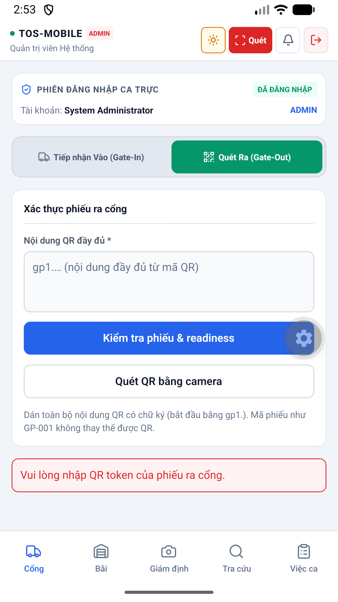\n\nMàn hình 43 Gate Out Light thuộc phân hệ Cổng. Hỗ trợ nhân viên bảo vệ quét mã QR, đối chiếu thông tin xe tải, tình trạng kẹp chì (seal) và ghi nhận thời gian xe ra vào ICD chính xác.\n\n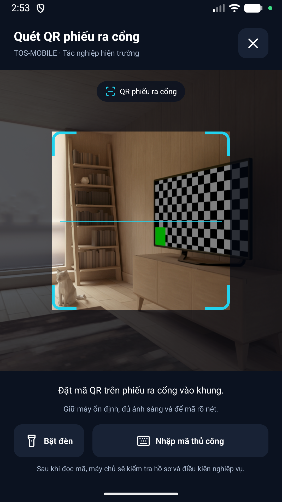\n\nGiao diện 44 Scanner Ready Light được thiết kế tối ưu trên thiết bị di động, hỗ trợ cả chế độ Sáng (Light mode) và Tối (Dark mode), giúp nhân viên dễ quan sát ngoài trời nắng gắt hoặc ban đêm.\n\n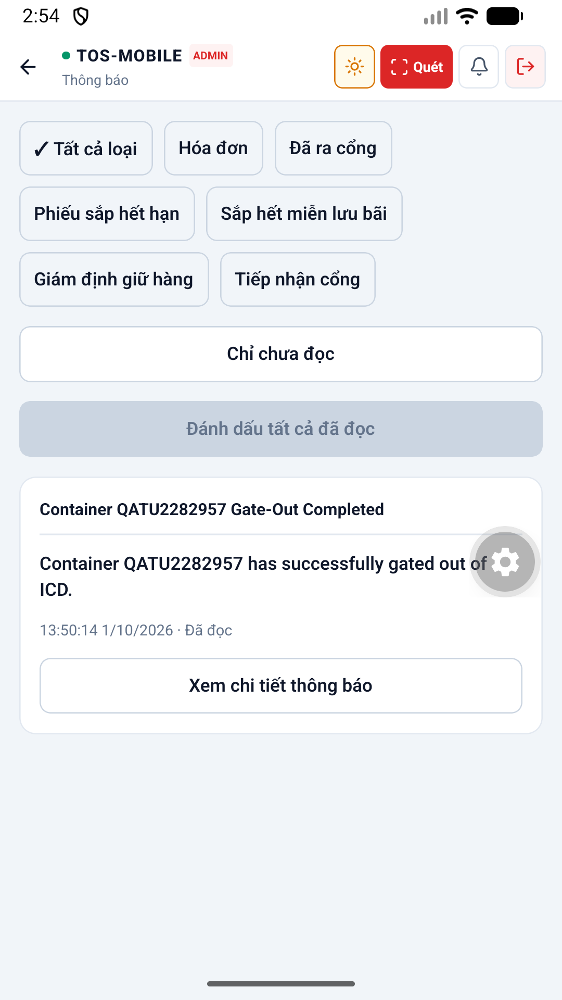\n\nGiao diện 45 Notifications Light được thiết kế tối ưu trên thiết bị di động, hỗ trợ cả chế độ Sáng (Light mode) và Tối (Dark mode), giúp nhân viên dễ quan sát ngoài trời nắng gắt hoặc ban đêm.\n\n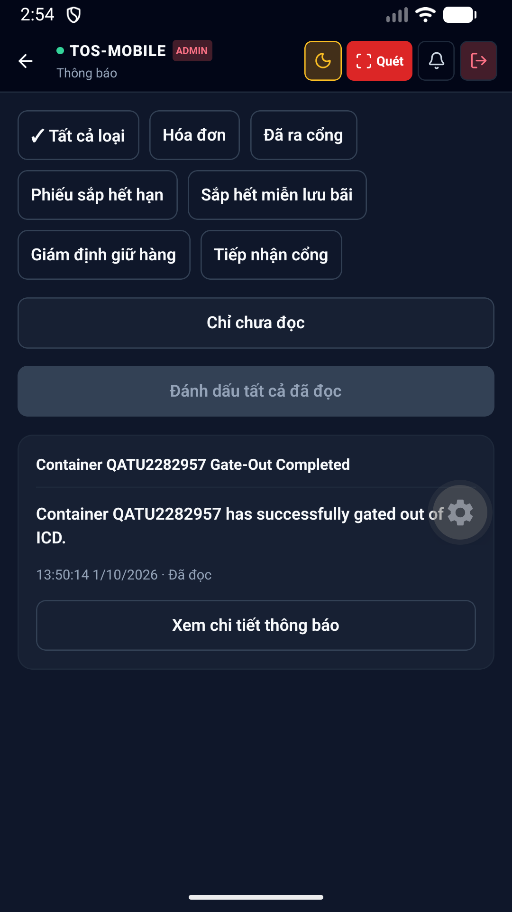\n\nGiao diện 46 Notifications Dark được thiết kế tối ưu trên thiết bị di động, hỗ trợ cả chế độ Sáng (Light mode) và Tối (Dark mode), giúp nhân viên dễ quan sát ngoài trời nắng gắt hoặc ban đêm.\n\n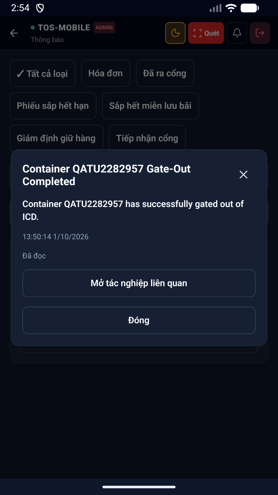\n\nGiao diện 47 Notification Detail Dark được thiết kế tối ưu trên thiết bị di động, hỗ trợ cả chế độ Sáng (Light mode) và Tối (Dark mode), giúp nhân viên dễ quan sát ngoài trời nắng gắt hoặc ban đêm.\n\n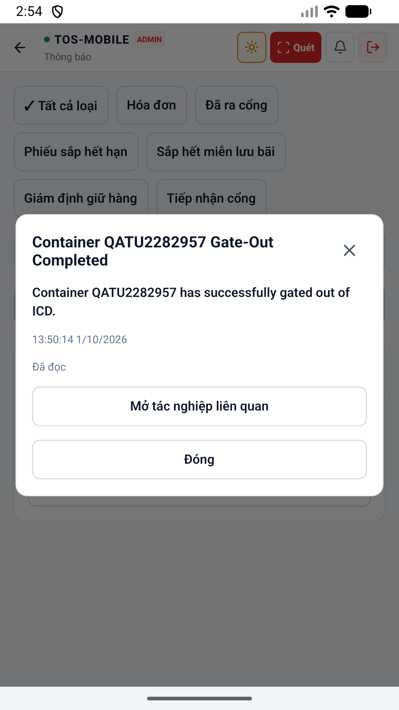\n\nGiao diện 48 Notification Detail Light được thiết kế tối ưu trên thiết bị di động, hỗ trợ cả chế độ Sáng (Light mode) và Tối (Dark mode), giúp nhân viên dễ quan sát ngoài trời nắng gắt hoặc ban đêm.\n\n\n\nGiao diện 49 Account Light được thiết kế tối ưu trên thiết bị di động, hỗ trợ cả chế độ Sáng (Light mode) và Tối (Dark mode), giúp nhân viên dễ quan sát ngoài trời nắng gắt hoặc ban đêm.\n\n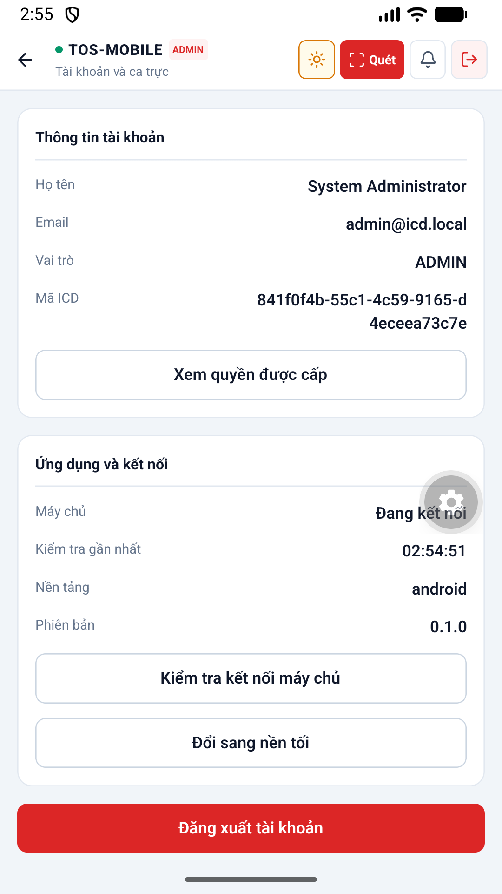\n\nGiao diện 50 Account Permissions Light được thiết kế tối ưu trên thiết bị di động, hỗ trợ cả chế độ Sáng (Light mode) và Tối (Dark mode), giúp nhân viên dễ quan sát ngoài trời nắng gắt hoặc ban đêm.\n\n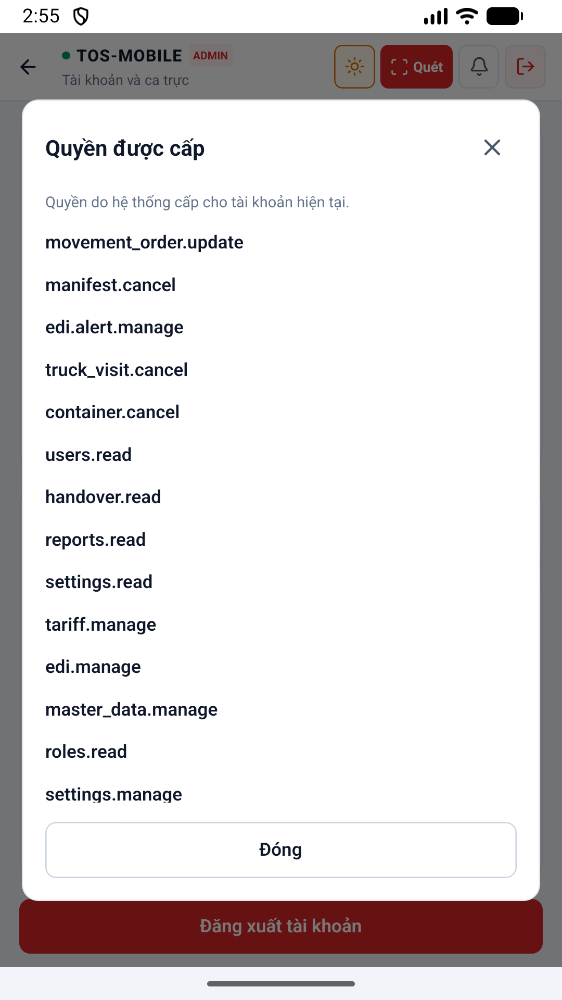\n\nGiao diện 51 Account Permissions Light được thiết kế tối ưu trên thiết bị di động, hỗ trợ cả chế độ Sáng (Light mode) và Tối (Dark mode), giúp nhân viên dễ quan sát ngoài trời nắng gắt hoặc ban đêm.\n\n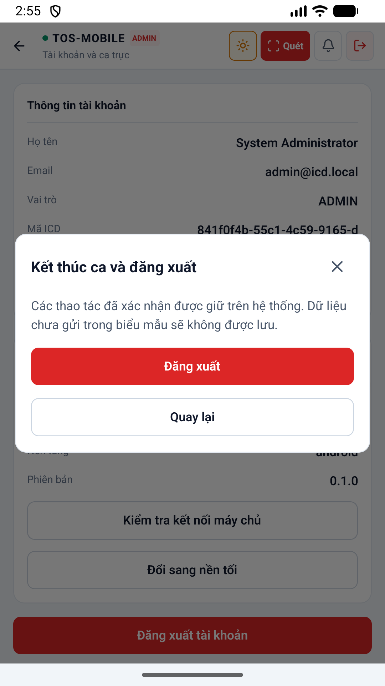\n\nGiao diện 52 Logout Confirm Light được thiết kế tối ưu trên thiết bị di động, hỗ trợ cả chế độ Sáng (Light mode) và Tối (Dark mode), giúp nhân viên dễ quan sát ngoài trời nắng gắt hoặc ban đêm.\n\n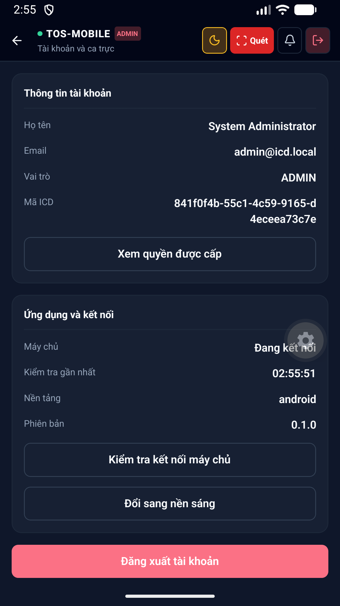\n\nGiao diện 53 Account Dark được thiết kế tối ưu trên thiết bị di động, hỗ trợ cả chế độ Sáng (Light mode) và Tối (Dark mode), giúp nhân viên dễ quan sát ngoài trời nắng gắt hoặc ban đêm.\n\n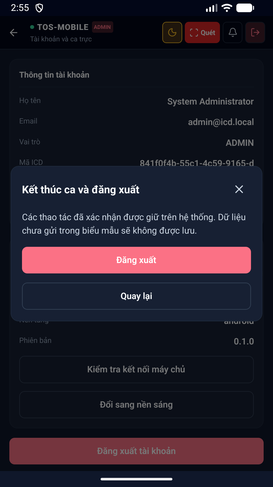\n\nGiao diện 54 Logout Confirm Dark được thiết kế tối ưu trên thiết bị di động, hỗ trợ cả chế độ Sáng (Light mode) và Tối (Dark mode), giúp nhân viên dễ quan sát ngoài trời nắng gắt hoặc ban đêm.\n\n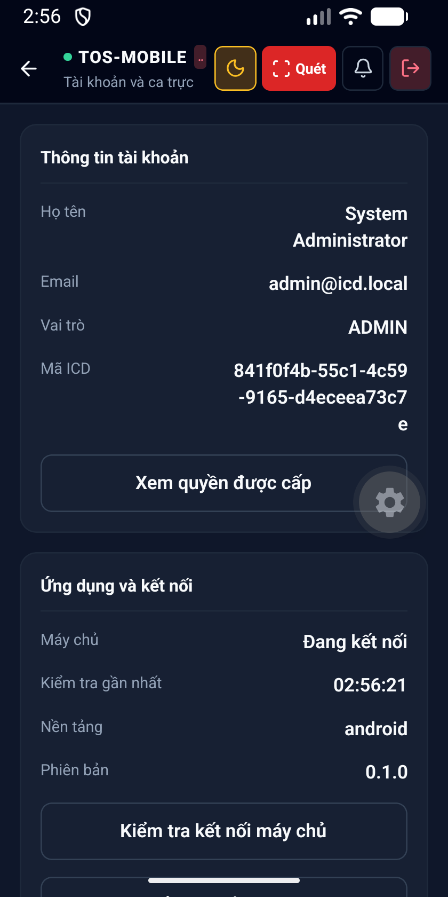\n\nGiao diện 55 Account 320Dp Dark được thiết kế tối ưu trên thiết bị di động, hỗ trợ cả chế độ Sáng (Light mode) và Tối (Dark mode), giúp nhân viên dễ quan sát ngoài trời nắng gắt hoặc ban đêm.\n\n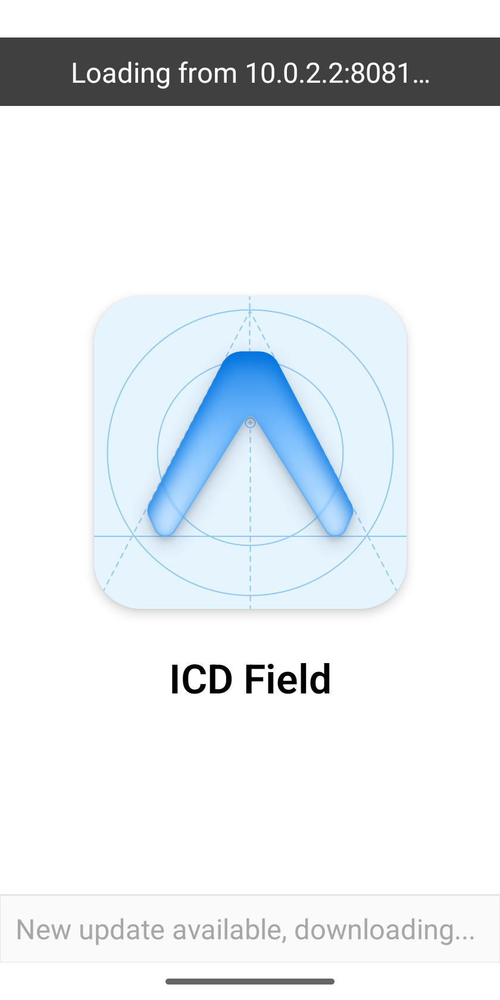\n\nGiao diện 56 Account 320Dp Font150 Dark được thiết kế tối ưu trên thiết bị di động, hỗ trợ cả chế độ Sáng (Light mode) và Tối (Dark mode), giúp nhân viên dễ quan sát ngoài trời nắng gắt hoặc ban đêm.\n\n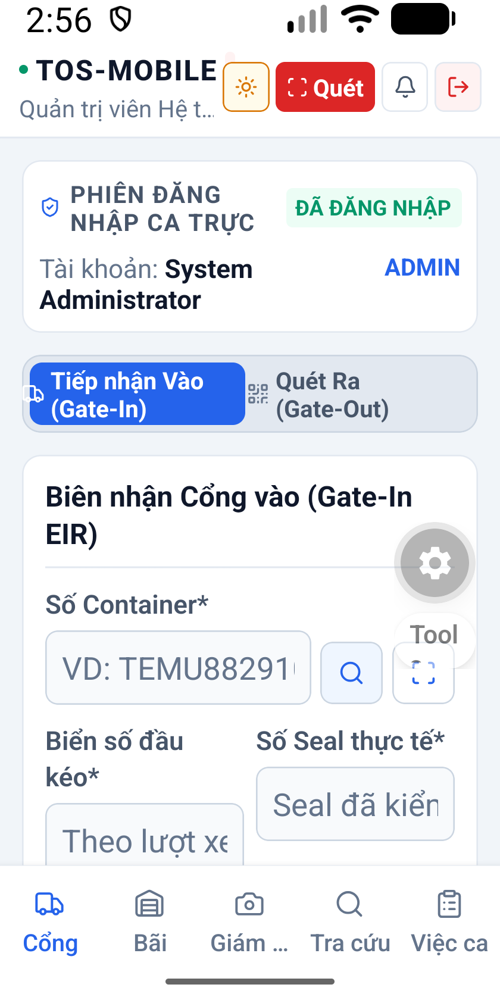\n\nMàn hình 57 Gate 320Dp Font150 Light thuộc phân hệ Cổng. Hỗ trợ nhân viên bảo vệ quét mã QR, đối chiếu thông tin xe tải, tình trạng kẹp chì (seal) và ghi nhận thời gian xe ra vào ICD chính xác.\n\n\n\nMàn hình 58 Restored Gate Light thuộc phân hệ Cổng. Hỗ trợ nhân viên bảo vệ quét mã QR, đối chiếu thông tin xe tải, tình trạng kẹp chì (seal) và ghi nhận thời gian xe ra vào ICD chính xác.\n\n\n\nMàn hình 59 Restored Gate Light thuộc phân hệ Cổng. Hỗ trợ nhân viên bảo vệ quét mã QR, đối chiếu thông tin xe tải, tình trạng kẹp chì (seal) và ghi nhận thời gian xe ra vào ICD chính xác.\n\n\n\nGiao diện 60 Camera Revoked Main được thiết kế tối ưu trên thiết bị di động, hỗ trợ cả chế độ Sáng (Light mode) và Tối (Dark mode), giúp nhân viên dễ quan sát ngoài trời nắng gắt hoặc ban đêm.\n\n\n\nGiao diện 61 Camera Revoked Main được thiết kế tối ưu trên thiết bị di động, hỗ trợ cả chế độ Sáng (Light mode) và Tối (Dark mode), giúp nhân viên dễ quan sát ngoài trời nắng gắt hoặc ban đêm.\n\n\n\nGiao diện 62 Camera Revoked Main được thiết kế tối ưu trên thiết bị di động, hỗ trợ cả chế độ Sáng (Light mode) và Tối (Dark mode), giúp nhân viên dễ quan sát ngoài trời nắng gắt hoặc ban đêm.\n\n\n\nGiao diện 63 Scanner Denied Light được thiết kế tối ưu trên thiết bị di động, hỗ trợ cả chế độ Sáng (Light mode) và Tối (Dark mode), giúp nhân viên dễ quan sát ngoài trời nắng gắt hoặc ban đêm.\n\n\n\nMàn hình 64 Gate In Bottom Light thuộc phân hệ Cổng. Hỗ trợ nhân viên bảo vệ quét mã QR, đối chiếu thông tin xe tải, tình trạng kẹp chì (seal) và ghi nhận thời gian xe ra vào ICD chính xác.\n\n\n\nGiao diện 65 Truck Arrival Form Light được thiết kế tối ưu trên thiết bị di động, hỗ trợ cả chế độ Sáng (Light mode) và Tối (Dark mode), giúp nhân viên dễ quan sát ngoài trời nắng gắt hoặc ban đêm.\n\n\n\nGiao diện 66 Truck Arrival Form Dark được thiết kế tối ưu trên thiết bị di động, hỗ trợ cả chế độ Sáng (Light mode) và Tối (Dark mode), giúp nhân viên dễ quan sát ngoài trời nắng gắt hoặc ban đêm.\n\n\n\nMàn hình 67 Yard Operations Bottom Dark thuộc phân hệ Bãi. Giúp nhân viên điều độ xe nâng gán vị trí (Block, Bay, Row, Tier) cho container trên bản đồ bãi dạng lưới 2D.\n\n\n\nGiao diện 68 Operations Type Picker Dark được thiết kế tối ưu trên thiết bị di động, hỗ trợ cả chế độ Sáng (Light mode) và Tối (Dark mode), giúp nhân viên dễ quan sát ngoài trời nắng gắt hoặc ban đêm.\n\n\n\nMàn hình 69 Yard Booking Form Dark thuộc phân hệ Bãi. Giúp nhân viên điều độ xe nâng gán vị trí (Block, Bay, Row, Tier) cho container trên bản đồ bãi dạng lưới 2D.\n\n\n\nMàn hình 70 Yard Booking Form Dark thuộc phân hệ Bãi. Giúp nhân viên điều độ xe nâng gán vị trí (Block, Bay, Row, Tier) cho container trên bản đồ bãi dạng lưới 2D.\n\n\n\nMàn hình 71 Yard Booking Form Light thuộc phân hệ Bãi. Giúp nhân viên điều độ xe nâng gán vị trí (Block, Bay, Row, Tier) cho container trên bản đồ bãi dạng lưới 2D.\n\n\n\nGiao diện 72 Booking Container Picker Light được thiết kế tối ưu trên thiết bị di động, hỗ trợ cả chế độ Sáng (Light mode) và Tối (Dark mode), giúp nhân viên dễ quan sát ngoài trời nắng gắt hoặc ban đêm.\n\n\n\nGiao diện 73 Booking Draft Light được thiết kế tối ưu trên thiết bị di động, hỗ trợ cả chế độ Sáng (Light mode) và Tối (Dark mode), giúp nhân viên dễ quan sát ngoài trời nắng gắt hoặc ban đêm.\n\n\n\nGiao diện 74 Booking Draft Bottom Light được thiết kế tối ưu trên thiết bị di động, hỗ trợ cả chế độ Sáng (Light mode) và Tối (Dark mode), giúp nhân viên dễ quan sát ngoài trời nắng gắt hoặc ban đêm.\n\n\n\nGiao diện 75 Booking Confirm Light được thiết kế tối ưu trên thiết bị di động, hỗ trợ cả chế độ Sáng (Light mode) và Tối (Dark mode), giúp nhân viên dễ quan sát ngoài trời nắng gắt hoặc ban đêm.\n\n\n\nGiao diện 76 Booking Confirm Dark được thiết kế tối ưu trên thiết bị di động, hỗ trợ cả chế độ Sáng (Light mode) và Tối (Dark mode), giúp nhân viên dễ quan sát ngoài trời nắng gắt hoặc ban đêm.\n\n\n\nGiao diện 77 Lookup Results Dark được thiết kế tối ưu trên thiết bị di động, hỗ trợ cả chế độ Sáng (Light mode) và Tối (Dark mode), giúp nhân viên dễ quan sát ngoài trời nắng gắt hoặc ban đêm.\n\n\n\nGiao diện 78 Container Detail Dark được thiết kế tối ưu trên thiết bị di động, hỗ trợ cả chế độ Sáng (Light mode) và Tối (Dark mode), giúp nhân viên dễ quan sát ngoài trời nắng gắt hoặc ban đêm.\n\n\n\nGiao diện 79 Container Detail Light được thiết kế tối ưu trên thiết bị di động, hỗ trợ cả chế độ Sáng (Light mode) và Tối (Dark mode), giúp nhân viên dễ quan sát ngoài trời nắng gắt hoặc ban đêm.\n\n\n\nGiao diện 80 Container Readiness Light được thiết kế tối ưu trên thiết bị di động, hỗ trợ cả chế độ Sáng (Light mode) và Tối (Dark mode), giúp nhân viên dễ quan sát ngoài trời nắng gắt hoặc ban đêm.\n\n\n\nGiao diện 81 Container Handover History Light được thiết kế tối ưu trên thiết bị di động, hỗ trợ cả chế độ Sáng (Light mode) và Tối (Dark mode), giúp nhân viên dễ quan sát ngoài trời nắng gắt hoặc ban đêm.\n\n\n\nGiao diện 82 Container Handover History Dark được thiết kế tối ưu trên thiết bị di động, hỗ trợ cả chế độ Sáng (Light mode) và Tối (Dark mode), giúp nhân viên dễ quan sát ngoài trời nắng gắt hoặc ban đêm.\n\n\n\nGiao diện 83 Container Readiness Dark được thiết kế tối ưu trên thiết bị di động, hỗ trợ cả chế độ Sáng (Light mode) và Tối (Dark mode), giúp nhân viên dễ quan sát ngoài trời nắng gắt hoặc ban đêm.\n\n\n\nGiao diện 84 Session Reopened Light được thiết kế tối ưu trên thiết bị di động, hỗ trợ cả chế độ Sáng (Light mode) và Tối (Dark mode), giúp nhân viên dễ quan sát ngoài trời nắng gắt hoặc ban đêm.\n\n\n\nGiao diện 85 Final Restored được thiết kế tối ưu trên thiết bị di động, hỗ trợ cả chế độ Sáng (Light mode) và Tối (Dark mode), giúp nhân viên dễ quan sát ngoài trời nắng gắt hoặc ban đêm.\n\n\n\nMàn hình 86 Survey History Light hỗ trợ nhân viên Giám định (Surveyor) ghi nhận tình trạng hư hỏng của vỏ container bằng cách chọn các mã lỗi chuẩn quốc tế.\n\n\n\nGiao diện 87 Inspection Hold Detail Light được thiết kế tối ưu trên thiết bị di động, hỗ trợ cả chế độ Sáng (Light mode) và Tối (Dark mode), giúp nhân viên dễ quan sát ngoài trời nắng gắt hoặc ban đêm.\n\n\n\nGiao diện 88 Inspection Hold Detail Dark được thiết kế tối ưu trên thiết bị di động, hỗ trợ cả chế độ Sáng (Light mode) và Tối (Dark mode), giúp nhân viên dễ quan sát ngoài trời nắng gắt hoặc ban đêm.\n\n\n\nGiao diện 89 Booking List Dark được thiết kế tối ưu trên thiết bị di động, hỗ trợ cả chế độ Sáng (Light mode) và Tối (Dark mode), giúp nhân viên dễ quan sát ngoài trời nắng gắt hoặc ban đêm.\n\n\n\nGiao diện 90 Booking Detail Dark được thiết kế tối ưu trên thiết bị di động, hỗ trợ cả chế độ Sáng (Light mode) và Tối (Dark mode), giúp nhân viên dễ quan sát ngoài trời nắng gắt hoặc ban đêm.\n\n\n\nGiao diện 91 Booking Detail Light được thiết kế tối ưu trên thiết bị di động, hỗ trợ cả chế độ Sáng (Light mode) và Tối (Dark mode), giúp nhân viên dễ quan sát ngoài trời nắng gắt hoặc ban đêm.\n\n\n\nGiao diện 92 Final Restored được thiết kế tối ưu trên thiết bị di động, hỗ trợ cả chế độ Sáng (Light mode) và Tối (Dark mode), giúp nhân viên dễ quan sát ngoài trời nắng gắt hoặc ban đêm.\n\n# CHƯƠNG 6: KẾT LUẬN\n\nHệ thống đã triển khai thành công kiến trúc Monorepo, tích hợp trơn tru giữa ứng dụng di động React Native và backend NestJS, cùng với hệ thống cơ sở dữ liệu MySQL 53 bảng vững chắc. Các nghiệp vụ lõi như Gate-in, Yard Assignment và Billing đều đã được hiện thực hóa.\n\n