# Lộ trình demo nghiệp vụ ICD bằng ứng dụng mobile

**Mục đích:** trình bày trước giảng viên cách nhân viên cổng và nhân viên bãi xử lý một container từ lúc xe đến ICD đến lúc ra cổng. Bản này dành cho một buổi demo trực tiếp khoảng **15–18 phút** trên Android/Expo Go. Người trình bày có thể dùng phần “Lời dẫn” gần như nguyên văn, nhưng nên nói tự nhiên theo dữ liệu đang xuất hiện trên màn hình.

**Phạm vi đúng của app:** mobile phục vụ tác nghiệp tại hiện trường: Cổng, Bãi, Giám định, Tra cứu và Việc ca. Hồ sơ Manifest/BL, thanh toán và cấp Gate Pass do web/backend thực hiện. App không tự quyết định container được ra cổng; backend kiểm tra điều kiện và xác nhận giao dịch. Thuật toán tối ưu vị trí bãi chưa phải phần được nghiệm thu trong demo này; dùng thao tác **kiểm tra vị trí và xếp tay**.

## 1. Câu chuyện trình bày

> Một xe chở container đến ICD. Nhân viên cổng đối chiếu hồ sơ và lập biên nhận Gate-in. Nhân viên bãi nhận việc, kiểm tra ô trống và xếp container. Sau khi giám định, có thể tra cứu lại hồ sơ và lịch sử. Với một container khác đã hoàn tất các điều kiện trước đó, nhân viên cổng quét Gate Pass do hệ thống cấp, kiểm tra readiness rồi xác nhận Gate-out. Quét lại cùng phiếu phải bị từ chối.

```mermaid
flowchart LR
  A[Web/backend chuẩn bị hồ sơ và xe đến cổng] --> B[Mobile · Cổng: Gate-in]
  B --> C[Mobile · Việc ca: việc xếp bãi]
  C --> D[Mobile · Bãi: kiểm tra ô và xếp]
  D --> E[Mobile · Giám định: ghi biên bản]
  E --> F[Mobile · Tra cứu: trạng thái và lịch sử]
  F --> G[Web/backend: hoàn tất phí và cấp Gate Pass]
  G --> H[Mobile · Cổng: quét QR và Gate-out]
  H --> I[Tra cứu: EXITED, phiếu USED]
```

Để buổi trình bày không bị gián đoạn vì bước thanh toán/cấp phiếu trên web, chuẩn bị **hai hồ sơ khác nhau**. Hồ sơ **A** bắt đầu ở trước Gate-in để thao tác Cổng → Bãi → Giám định. Hồ sơ **B** đã ở bãi, đủ điều kiện ra cổng và có Gate Pass `ACTIVE` chưa hết hạn. Nếu cần minh họa kiểm soát rủi ro, dùng thêm hồ sơ **C** đang có `HOLD`.

## 2. Phiếu dữ liệu phải điền trước buổi demo

Không ghi mật khẩu, JWT hoặc nội dung QR có chữ ký vào tài liệu trình chiếu. Giữ các thông tin đăng nhập và QR ở nơi riêng, chỉ hiển thị khi cần quét.

| Mục | Giá trị cần chuẩn bị | Điều kiện phải kiểm trước khi bắt đầu |
|---|---|---|
| Môi trường | Audit/test riêng: `icd_ux_audit_20261003_e2e` hoặc môi trường demo cô lập tương đương | Không dùng hồ sơ khách hàng thật; app và API trỏ cùng một database |
| Tài khoản cổng | `GATE_STAFF`: __________ | Có tab **Cổng**, **Tra cứu**, **Việc ca** và quyền Gate-in/Gate-out |
| Tài khoản bãi | `YARD_STAFF`: __________ | Có tab **Bãi**, **Giám định**, **Tra cứu**, **Việc ca** |
| Container A | __________ | Lượt container `AUTHORIZED`, chưa có biên nhận Gate-in; xe đúng hồ sơ đã `ARRIVED` hoặc trạng thái được API chấp nhận |
| Xe của A | __________ | Biển số, tài xế, seal thực tế, gross weight mẫu đã thống nhất với hồ sơ; không dùng dữ liệu ngẫu nhiên trái validation |
| Ô bãi cho A | __________ | Ô thuộc ICD, phù hợp container, đang trống; có thêm một ô không hợp lệ để minh họa phản hồi kiểm tra nếu muốn |
| Giám định A | Loại __________; ghi chú __________ | Chọn trường hợp `PASS` để tiếp tục kể luồng thuận; không tạo `HOLD` trên A nếu sẽ dùng A cho bước ra cổng sau này |
| Container B | __________ | `IN_YARD`, đã có ô bãi, không có operational/inspection HOLD, không còn tác nghiệp chặn, nghĩa vụ phí đã hoàn tất |
| Gate Pass B | Mã hiển thị __________; giờ hết hạn __________ | Phiếu `ACTIVE`, QR/token thật được backend phát hành, chưa dùng, chưa hủy; **mã phiếu không thay cho QR token** |
| Container C, tùy chọn | __________ | Có `HOLD` hoặc một blocker readiness thật để minh họa từ chối; tuyệt đối không “bỏ qua” blocker trong app |

**Không tái sử dụng bộ QA cũ:** các container `QAOU5007550` và `QAOU1882075` trong [báo cáo tác nghiệp 02/10](../../test-artifacts/2026-10-01-mobile-operations-audit/REPORT.md) đã `EXITED` và Gate Pass đã `USED`. Chúng chỉ phù hợp để mở ảnh lịch sử, không thể dùng làm phiếu ra cổng còn hiệu lực.

## 3. Chuẩn bị thiết bị và dữ liệu

- [ ] Chạy `start-icd.bat -Check`, xử lý prerequisite được báo, rồi chạy `start-icd.bat` ở chế độ Audit/test. Theo [README](../../README.md), mặc định API ở `127.0.0.1:3001/api`, web ở `127.0.0.1:5174`, Metro/Expo ở cổng `8081`. BAT **không tự seed dữ liệu**.
- [ ] Nếu dùng Expo Go trên **điện thoại thật**, đặt `EXPO_PUBLIC_API_BASE_URL` trong `apps/mobile/.env` bằng địa chỉ IPv4 LAN của máy chạy API và cổng `3001`, sau đó reload app. `127.0.0.1` trên điện thoại là chính điện thoại, không phải laptop. Nếu dùng Android emulator, kiểm lại đường kết nối API phù hợp với emulator.
- [ ] Mở app và xem chỉ báo kết nối/tài khoản. Đăng nhập từng vai trò một lần trước buổi trình bày để phát hiện sớm lỗi quyền hoặc phiên.
- [ ] Chuẩn bị mới A, B và tùy chọn C qua web/API trong **database demo**; đọc lại trạng thái sau khi chuẩn bị. Không dùng bản ghi đã Gate-in/Gate-out trong lần chạy trước.
- [ ] Thử việc mở camera trên thiết bị sẽ trình chiếu. Có sẵn phương án nhập tay token QR nếu camera, quyền truy cập hoặc màn hình chiếu gặp trục trặc.
- [ ] Sạc máy, tắt thông báo cá nhân, tăng cỡ chữ ở mức đọc được trên máy chiếu, kiểm tra Wi-Fi giữa thiết bị và API. Để sẵn ảnh trong [gallery tác nghiệp](../../test-artifacts/2026-10-01-mobile-operations-audit/gallery.html) làm tư liệu dự phòng, ghi rõ đó là ảnh kiểm thử trước đây.
- [ ] Chụp nhanh màn hình trạng thái ban đầu của A và B. Sau mỗi giao dịch quan trọng, kéo để làm mới hoặc mở lại Tra cứu để chứng minh dữ liệu đã lưu ở backend.

## 4. Kịch bản thao tác trực tiếp: 15–18 phút

| Thời gian | Vai trò / màn hình | Thao tác trực tiếp | Kết quả cần chỉ trên màn hình | Lời dẫn gợi ý |
|---|---|---|---|---|
| 0:00–1:00 | Mở app, **Tài khoản và ca trực** | Giới thiệu các tab; mở tài khoản để chỉ vai trò đang đăng nhập. | Giao diện hiện đúng quyền, kết nối server. | “Ứng dụng dành cho người làm việc ở cổng và bãi. Mỗi tài khoản chỉ thấy và thực hiện những tác vụ được cấp quyền.” |
| 1:00–4:00 | `GATE_STAFF` → **Cổng** → **Biên nhận Cổng vào** | Nhập/quét số container A, chọn **lượt container cần tiếp nhận**, chọn **xe đã đến cổng**; điền biển số, seal thực tế, tài xế và các trường cần thiết; chọn **Kiểm tra lại hồ sơ**, xem dialog rồi **Tiếp nhận container**. | Biên nhận Gate-in thành công; visit A chuyển `IN_YARD`; nếu chưa xếp ô, vị trí là “Chưa có vị trí”. | “Nhân viên cổng không nhập container tùy ý. App đối chiếu lượt và xe đã được hệ thống ghi nhận, sau đó gửi biên nhận để backend xác nhận.” |
| 4:00–5:00 | **Việc ca** | Tìm việc **Xếp bãi** cho A; mở thẻ việc nếu có. Nếu queue cập nhật chậm, kéo để làm mới. | Việc gắn đúng container/lượt; không nhầm với xe hoặc lượt khác. | “Sau Gate-in, container đã vào ICD nhưng còn thiếu ô bãi. Việc này xuất hiện cho nhân viên phù hợp.” |
| 5:00–8:00 | Đổi sang `YARD_STAFF` → **Bãi** | Chọn A; quan sát vị trí hiện tại; nhập ô đã chuẩn bị, bấm **Kiểm tra vị trí nhập tay** hoặc trong màn việc bấm **Kiểm tra vị trí**; sau khi đạt, bấm **Xác nhận xếp vị trí** và xác nhận dialog. Có thể mở **Sơ đồ vị trí bãi — Tổng quan** để chỉ ô và Legend. | A có mã ô `Block–Row–Bay–Tier`; ô đã nhận container; Legend tương ứng trạng thái trên bản đồ. | “Hệ thống kiểm tra ô theo dữ liệu bãi trước khi lưu. Gợi ý/tối ưu tự động chưa phải phần em trình bày là đã hoàn thiện; ở đây nhân viên chọn ô và được hệ thống xác nhận.” |
| 8:00–10:00 | **Giám định** | Chọn A, loại giám định phù hợp; nhập nội dung thực tế, chọn kết quả `PASS` khi hồ sơ demo cho phép; bấm **Gửi biên bản Giám định** và xác nhận. | Biên bản xuất hiện trong lịch sử, đúng container và loại giám định. | “Kết quả giám định được lưu như một tác nghiệp có thể truy vết. Nếu kết quả là HOLD, hệ thống phải chặn cấp phiếu ra cổng.” |
| 10:00–11:00 | **Tra cứu** → **Tìm kiếm container** | Tìm A; mở chi tiết. | Trạng thái `IN_YARD`, vị trí vừa xếp, thời điểm vào cổng và lịch sử/tác nghiệp tương ứng. | “Em tải lại hồ sơ từ hệ thống để kiểm tra các bước vừa làm đã được lưu, không chỉ thay đổi trên màn hình.” |
| 11:00–14:30 | Đăng nhập lại `GATE_STAFF` → **Cổng · Quét phiếu ra** | Dùng QR thật của B: **Quét QR bằng camera** hoặc nhập token vào **Nội dung QR đầy đủ**; bấm **Kiểm tra phiếu & readiness**; mở **Mở màn xác nhận gate-out**; đối chiếu xe/container, bấm **Xem lại & xác nhận gate-out**, trên native **giữ khoảng 2 giây** để mở xác nhận, rồi xác nhận **Cho phép xe ra cổng?**. | Trước xác nhận: phiếu hợp lệ và readiness cho phép. Sau xác nhận: B `EXITED`, Gate Pass `USED`, vị trí được giải phóng theo kết quả backend. | “QR chỉ nhận dạng phiếu. Ngay lúc ra cổng, backend kiểm tra lại tình trạng bãi, tác nghiệp, HOLD và phí. Phiếu không thể dùng lại sau khi xe đã ra.” |
| 14:30–15:30 | **Tra cứu** hoặc **Quét phiếu tiếp theo** | Tải lại B; nếu còn thời gian, quét lại cùng QR. | Tra cứu cho thấy `EXITED`; quét lại phiếu `USED` bị từ chối, không tạo Gate-out thứ hai. | “Kết quả này chứng minh trạng thái được khóa ở backend; app không tự hiển thị thành công nếu giao dịch chưa được chấp nhận.” |
| 15:30–18:00 | Phần hỏi đáp / tình huống chặn, tùy thời gian | Mở C có `HOLD` và thử **Kiểm tra phiếu & readiness**, hoặc chỉ cho thầy xem blocker trong Tra cứu. | Hiện lý do chặn; không có đường xác nhận Gate-out hợp lệ. | “Khi có giám định HOLD hay nghĩa vụ chưa xong, hệ thống từ chối ra cổng. Nhân viên hiện trường không được sửa điều kiện nghiệp vụ này trên mobile.” |

### Lưu ý khi thao tác

1. Trong Gate-in, chọn đúng **lượt container** và **xe** thuộc A. Chỉ nhập một số container mà không chọn ngữ cảnh sẽ không chứng minh được luồng nghiệp vụ.
2. Ở Bãi, nút **Gợi ý vị trí trống** có thể xuất hiện nhưng không giới thiệu đó là thuật toán tối ưu đã hoàn thiện. Phần được trình diễn là kiểm tra ô và xác nhận xếp vị trí.
3. Với Giám định, `PASS` chỉ dùng nếu người trình bày đã chuẩn bị loại và kết quả hợp lệ. Không gửi `PASS` cho một lỗi thực tế chỉ để đạt luồng thuận. Nếu muốn minh họa `HOLD`, dùng hồ sơ C riêng.
4. Gate Pass B phải do backend phát hành. Không dùng mã container, mã phiếu hiển thị, QR giả hoặc token `gp1.invalid.signature` làm minh chứng Gate-out thành công.
5. Sau Gate-out, không thử chạy lại cùng một B để “lấy thêm ảnh”. Phiếu đã `USED`; cần chuẩn bị hồ sơ mới cho lần tập tiếp theo.

## 5. Bằng chứng nên chụp để đưa vào slide/báo cáo

| Ảnh | Nội dung cần thấy | Dùng để giải thích |
|---|---|---|
| 01 | Tài khoản `GATE_STAFF`, tab Cổng | Phân quyền theo vai trò |
| 02 | Form Gate-in đã chọn A và xe | Đối chiếu hồ sơ trước tiếp nhận; che thông tin cá nhân nếu có |
| 03 | Biên nhận Gate-in thành công | Backend đã ghi nhận vào ICD |
| 04 | Việc Xếp bãi cho A | Công việc chuyển giữa bộ phận |
| 05 | Kiểm tra ô và xác nhận xếp | Kiểm tra điều kiện vị trí |
| 06 | Sơ đồ bãi + Legend + ô A | Bản đồ phản ánh dữ liệu bãi |
| 07 | Biên bản giám định A | Lịch sử tác nghiệp tại hiện trường |
| 08 | Tra cứu A sau refresh | Dữ liệu Gate-in, ô và giám định đồng bộ |
| 09 | Readiness + phiếu B trước ra cổng | Backend quyết định điều kiện Gate-out |
| 10 | B sau Gate-out / phiếu `USED` | Giao dịch hoàn tất, không tái sử dụng QR |
| 11, tùy chọn | C bị `HOLD` | Trường hợp bị chặn đúng nghiệp vụ |

Đặt chú thích ảnh theo cấu trúc: **“Hình X. [Tên màn hình] – [hành động/kết quả]; nguồn: app ICD mobile, dữ liệu test ngày …”**. Nếu dùng ảnh từ [gallery lịch sử](../../test-artifacts/2026-10-01-mobile-operations-audit/gallery.html), ghi **“ảnh kiểm thử Expo Web ngày 02/10/2026”**; bộ ảnh đó không thay bằng chứng thao tác Android hiện tại. [Báo cáo scanner native](../../test-artifacts/2026-10-02-mobile-qr-scanner/REPORT.md) đã xác nhận camera/quyền/QR không hợp lệ trên Expo Go, nhưng chưa xác nhận một Gate Pass hợp lệ đi hết luồng Gate-out native; đây là bước cần chạy thật trong buổi tập demo.

## 6. Nếu thầy hỏi về ranh giới hệ thống

| Câu hỏi dễ gặp | Câu trả lời ngắn, đúng phạm vi |
|---|---|
| Vì sao không tạo Manifest hay hóa đơn trên điện thoại? | Mobile được thiết kế cho nhân viên hiện trường. Web xử lý hồ sơ, tài chính và cấp phiếu; mobile nhận việc, quét, kiểm tra và xác nhận tại cổng/bãi. |
| App có tự cho container ra khi quét đúng QR không? | Không. QR là đầu vào. Backend kiểm tra lại hiệu lực phiếu, trạng thái container, vị trí, HOLD, tác nghiệp và tài chính trước khi nhận Gate-out. |
| Điều gì xảy ra nếu mất mạng? | Các giao dịch Gate-in/Gate-out cần server trực tiếp; app không ghi nhận thành công offline và không tự phát lại một giao dịch đã nhập. |
| Bãi đã tối ưu tự động chưa? | Chưa. Hiện có bản đồ/Legend và kiểm tra ô trước khi xếp. Thuật toán tối ưu đang phát triển, nên demo thao tác xếp có kiểm soát. |
| Ai được làm từng việc? | `GATE_STAFF` thao tác cổng; `YARD_STAFF` xếp bãi/giám định. Quyền được backend kiểm tra khi gửi lệnh, không chỉ dựa vào việc ẩn nút trong app. |
| Handover cho đối tác nằm ở đâu? | Sau Gate-out, web/backend có thể tạo và theo dõi bàn giao theo policy. Mobile chỉ xem tóm tắt khi được cấp quyền, không thay partner API hay điều phối đối tác. |

## 7. Phương án dự phòng khi trình bày

- **Camera không nhận QR / chưa cấp quyền:** mở trạng thái quyền để giải thích, rồi dùng nút nhập tay và dán **token thật của B** trong môi trường demo. Vẫn phải bấm kiểm tra phiếu và để backend xác nhận.
- **Phiếu B đã hết hạn hoặc đã dùng:** dừng ở bước giải thích thông báo từ chối, đổi sang hồ sơ B dự phòng đã chuẩn bị. Không sửa trạng thái trực tiếp trong database giữa buổi trình bày.
- **API mất kết nối:** không cố thao tác Gate-in/Gate-out offline. Trình bày sơ đồ và ảnh kiểm thử có ghi rõ nguồn/thời điểm, sau đó hẹn chạy lại phần giao dịch khi API hồi phục.
- **Thiếu thời gian:** giữ bốn điểm: Gate-in A → xếp ô A → tra cứu A → Gate-out B. Bỏ phần giám định, tình huống HOLD và theme.
- **Có thêm thời gian:** mở thông báo hoặc Việc ca; cho xem thử một vị trí bãi không đạt điều kiện, rồi quay về vị trí đúng. Không tạo HOLD trên chính hồ sơ dùng để ra cổng.

## 8. Tiêu chí buổi tập đạt trước ngày bảo vệ

- [ ] Đã đi hết một lượt **trên đúng thiết bị và mạng sẽ dùng**, bấm tay từng bước, không chỉ kiểm tra qua trình duyệt.
- [ ] A Gate-in đúng xe và hiển thị `IN_YARD`; sau đó A có ô bãi và bản ghi giám định đúng lượt.
- [ ] B scan/kiểm tra bằng **QR hợp lệ thực**, hold-to-confirm chạy trên Android, backend trả thành công; tải lại thấy `EXITED` và phiếu `USED`.
- [ ] Quét lại B bị từ chối; C có blocker thì readiness hiển thị lý do đúng.
- [ ] Thời gian nói và chuyển tài khoản dưới 18 phút; máy chiếu nhìn rõ phần trạng thái, ô bãi và cảnh báo.
- [ ] Có bộ ảnh dự phòng và đã kiểm rằng đường dẫn gallery mở được trên máy trình chiếu.

**Nguồn đối chiếu:** [README hệ thống](../../README.md), [đặc tả mobile](../business/ICD_Mobile_Spec_v1.7_MySQL.md), mã màn hình trong `apps/mobile/src/features`, [kiểm thử tác nghiệp](../../test-artifacts/2026-10-01-mobile-operations-audit/REPORT.md) và [kiểm thử scanner](../../test-artifacts/2026-10-02-mobile-qr-scanner/REPORT.md). Nội dung trên là **kịch bản cần chạy và kiểm chứng**; nó không khẳng định các hồ sơ A/B/C hoặc phiên demo ngày trình bày đã được tạo sẵn.
